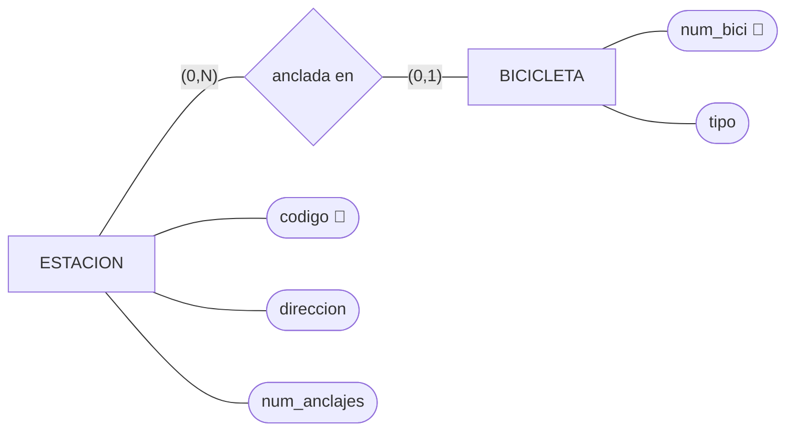
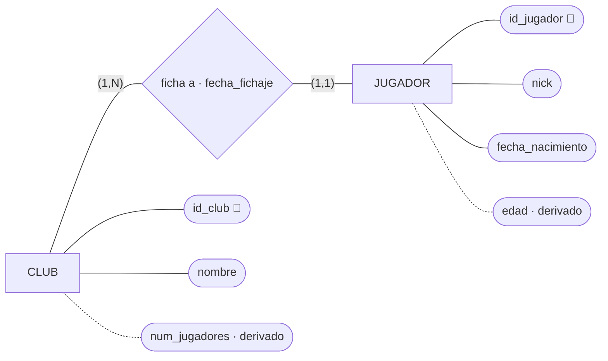
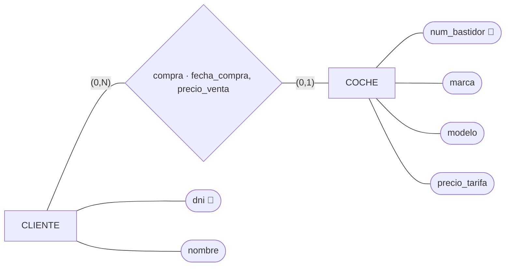
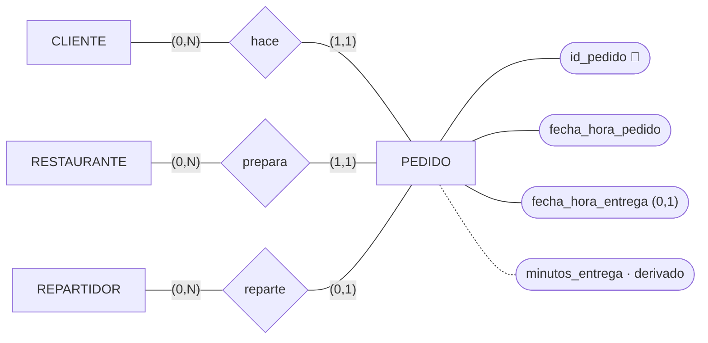
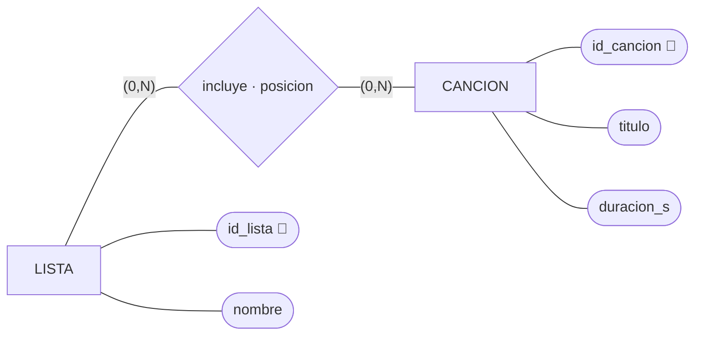
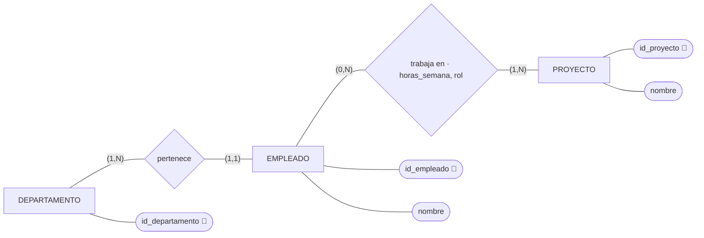
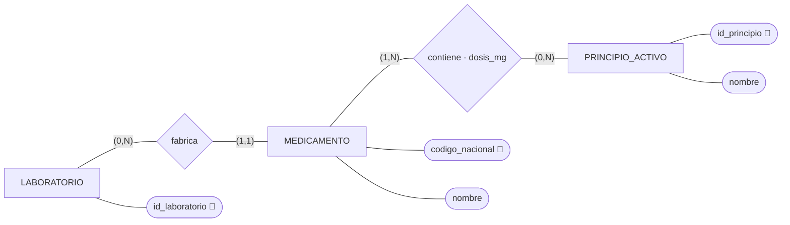
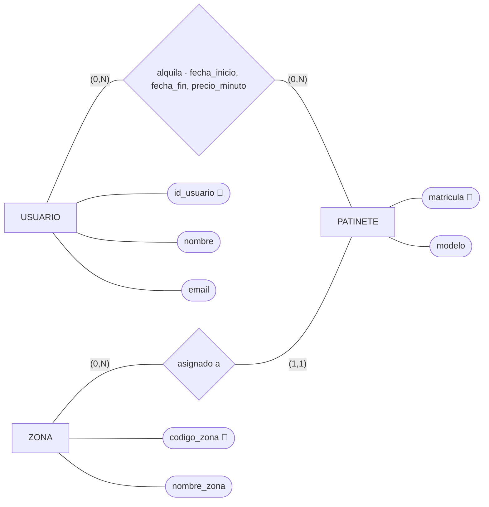

# GBD · Ejercicios E/R 4 · Paso a tablas, reglas 1 a 3

Nueve ejercicios para hacer en clase, por parejas, de menos a más. En los siete primeros el
diagrama E/R ya está hecho: solo hay que pasarlo a tablas. En el 8 haces tú el E/R. El 9 va al
revés: de las tablas al E/R.

La teoría está en [`teoria-2-er-y-relacional.md`](teoria-2-er-y-relacional.md):
apartado 2.3 (notación), 2.5 (reglas 1 a 3) y 1.6 (dato derivado y dato histórico).

| # | Dominio | Qué practica |
|---|---|---|
| 1 | Bicicletas municipales | Regla 2 con mínimo 0: clave ajena que admite nulo |
| 2 | Clubes de e-sports | Regla 2 con mínimo 1. Clave alternativa. Atributo de la relación. Derivados |
| 3 | Concesionario | Atributos de una 1:N opcional. Dato histórico |
| 4 | Comida a domicilio | Tres relaciones 1:N hacia la misma tabla |
| 5 | Listas de reproducción | Regla 3. ¿Puede repetirse la pareja? |
| 6 | Proyectos | Reglas 2 y 3 juntas, con atributos en la N:M |
| 7 | Medicamentos | Reglas 2 y 3 juntas |
| 8 | Alquiler de patinetes | Todo: haces el E/R. Una relación que guarda historia |
| 9 | Festival de música | Al revés: de las tablas al E/R |

## Qué se hace en cada ejercicio

| # | Qué | Cómo |
|---|---|---|
| A | Las tablas | Notación de texto del apartado 2.3: `PK`, `FK → TABLA`, `?` para lo que admite nulo, `UK(…)` |
| B | La regla de cada clave ajena y de cada tabla que no sale de una entidad | Una línea: «`id_estacion` en BICICLETA: regla 2, BICICLETA tiene `(0,1)`» |
| C | Las preguntas del ejercicio | Qué tablas miras y por qué columnas las enlazas |

Antes de poner una clave ajena, pregúntate: **una ocurrencia de esta entidad, ¿con cuántas de la
otra como máximo?** Si la respuesta es una, la clave ajena va aquí.

Si te da tiempo, monta el 4 y el 6 en DrawDB y comprueba que la pata de gallo dice lo mismo que las
cardinalidades del E/R.

---

## 1 · Bicicletas municipales

> El ayuntamiento tiene estaciones de bicicletas. De cada estación, un código, la dirección y el
> número de anclajes. De cada bicicleta, su número y el tipo (mecánica o eléctrica). Una bicicleta
> está anclada en una estación o circulando; en una estación hay muchas bicicletas.



Preguntas: ¿qué bicicletas están circulando ahora? ¿Cuántas hay en la estación `E-07`?

### A. Las tablas

    ESTACION(codigo PK, direccion, num_anclajes)
    BICICLETA(num_bici PK, tipo, codigo_estacion FK → ESTACION ?)

### B. Justificación de claves ajenas

* `codigo_estacion` en **BICICLETA**: Regla 2 (relación 1:N). La FK va en **BICICLETA** porque tiene cardinalidad `(0,1)`. Lleva `?` (admite nulos) porque su cardinalidad mínima es 0.

### C. Preguntas del ejercicio

* **¿Qué bicicletas están circulando ahora?**
  * **Tablas:** `BICICLETA`
  * **Enlace / Condición:** Filtrar `codigo_estacion IS NULL`.
* **¿Cuántas hay en la estación `E-07`?**
  * **Tablas:** `BICICLETA`
  * **Enlace / Condición:** Contar registros filtrando por `codigo_estacion = 'E-07'`.

---

## 2 · Clubes de e-sports

> Cada jugador ficha por un club, y un club tiene al menos un jugador. De cada club, nombre (no se
> repite). De cada jugador, su nick, que es único, y su fecha de nacimiento. Se guarda la fecha de
> fichaje. Interesa también la edad de cada jugador y cuántos jugadores tiene cada club.



Preguntas: ¿en qué club juega el nick `Zeta`? ¿Desde cuándo? ¿Qué jugadores tiene el club con más
jugadores?

Piensa: `nick` es único, pero la clave es `id_jugador`. ¿Qué es entonces `nick`?

### A. Las tablas

    CLUB(id_club PK, nombre)  -- UK(nombre)
    JUGADOR(id_jugador PK, nick, fecha_nacimiento, id_club FK → CLUB, fecha_fichaje)  -- UK(nick)

> *Nota: Los atributos derivados `num_jugadores` (en CLUB) y `edad` (en JUGADOR) no se guardan en las tablas.*

### B. Justificación de claves ajenas

* `id_club` en **JUGADOR**: Regla 2 (relación 1:N). La FK va en **JUGADOR** porque tiene cardinalidad `(1,1)`. No lleva `?` porque el mínimo es 1.
* `fecha_fichaje`: Atributo de una relación 1:N, migra a la tabla del lado N (**JUGADOR**) junto con la FK.

### C. Preguntas y Piensa

* **¿En qué club juega el nick `Zeta`? ¿Desde cuándo?**
  * **Tablas:** `JUGADOR` y `CLUB`
  * **Enlace:** `JUGADOR.id_club = CLUB.id_club`, filtrando por `JUGADOR.nick = 'Zeta'`. Se obtienen `CLUB.nombre` y `JUGADOR.fecha_fichaje`.
* **¿Qué jugadores tiene el club con más jugadores?**
  * **Tablas:** `CLUB` y `JUGADOR`
  * **Enlace:** `CLUB.id_club = JUGADOR.id_club`, agrupando por club y contando jugadores para obtener los miembros del máximo.
* **Piensa (`nick`):**
  * `nick` es una **clave alternativa** (candidate key). Como la PK es `id_jugador`, `nick` se define con restricción de unicidad: `UK(nick)`.

---

## 3 · Concesionario

> De cada coche, el número de bastidor, la marca, el modelo y el precio de tarifa. Un coche lo compra
> como mucho un cliente; un cliente puede comprar varios coches o ninguno (hay clientes que solo han
> pedido presupuesto). De cada compra se guarda la fecha y el precio que se pagó, que puede no
> coincidir con el de tarifa por los descuentos.



Preguntas: ¿qué coches no se han vendido? ¿Qué descuento se hizo en cada venta?

Piensa: ¿`precio_venta` es derivado de `precio_tarifa`? ¿Puede `fecha_compra` estar rellena y el
cliente vacío?

### A. Las tablas

    CLIENTE(dni PK, nombre)
    COCHE(num_bastidor PK, marca, modelo, precio_tarifa, dni_cliente FK → CLIENTE ?, fecha_compra ?, precio_venta ?)

### B. Justificación de claves ajenas

* `dni_cliente` en **COCHE**: Regla 2 (relación 1:N). La FK va en **COCHE** porque tiene cardinalidad `(0,1)`. Lleva `?` porque su cardinalidad mínima es 0 (el coche puede no estar vendido).
* `fecha_compra` y `precio_venta`: Atributos de la relación 1:N, migran a la tabla **COCHE** junto con la FK y llevan `?` porque solo tienen valor si el coche se ha vendido.

### C. Preguntas y Piensa

* **¿Qué coches no se han vendido?**
  * **Tablas:** `COCHE`
  * **Enlace / Condición:** Filtrar `dni_cliente IS NULL`.
* **¿Qué descuento se hizo en cada venta?**
  * **Tablas:** `COCHE`
  * **Enlace / Cálculo:** Restar `precio_tarifa - precio_venta` para las filas donde `dni_cliente IS NOT NULL`.
* **Piensa:**
  * **¿`precio_venta` es derivado de `precio_tarifa`?** No, es un dato real/histórico independiente fruto de una negociación o descuento acordado en la venta, no calculable mediante una regla fija.
  * **¿Puede `fecha_compra` estar rellena y el cliente vacío?** No. Si hay venta (`fecha_compra` no nulo), obligatoriamente debe existir un comprador (`dni_cliente` no nulo).

---

## 4 · Comida a domicilio

> Cada pedido lo hace un cliente y lo prepara un restaurante. Cuando se asigna, lo lleva un
> repartidor; hasta entonces, el pedido no tiene repartidor. De cada pedido, la fecha y hora en que se
> hizo y en la que se entregó, que está vacía mientras no llega. El tiempo de entrega se calcula.



Preguntas: ¿qué pedidos esperan repartidor? ¿Cuántos pedidos ha entregado cada repartidor? ¿Qué
restaurante tarda más de media?

### A. Las tablas

    CLIENTE(id_cliente PK, nombre, ...)
    RESTAURANTE(id_restaurante PK, nombre, ...)
    REPARTIDOR(id_repartidor PK, nombre, ...)
    PEDIDO(id_pedido PK, fecha_hora_pedido, fecha_hora_entrega ?, id_cliente FK → CLIENTE, id_restaurante FK → RESTAURANTE, id_repartidor FK → REPARTIDOR ?)

> *Nota: El atributo derivado `minutos_entrega` no se incluye en la tabla.*

### B. Justificación de claves ajenas

* `id_cliente` en **PEDIDO**: Regla 2 (relación 1:N). La FK va en **PEDIDO** por su cardinalidad `(1,1)`. No admite nulos.
* `id_restaurante` en **PEDIDO**: Regla 2 (relación 1:N). La FK va en **PEDIDO** por su cardinalidad `(1,1)`. No admite nulos.
* `id_repartidor` en **PEDIDO**: Regla 2 (relación 1:N). La FK va en **PEDIDO** por su cardinalidad `(0,1)`. Lleva `?` porque al principio el pedido no tiene repartidor asignado.

### C. Preguntas del ejercicio

* **¿Qué pedidos esperan repartidor?**
  * **Tablas:** `PEDIDO`
  * **Enlace / Condición:** Filtrar `id_repartidor IS NULL`.
* **¿Cuántos pedidos ha entregado cada repartidor?**
  * **Tablas:** `REPARTIDOR` y `PEDIDO`
  * **Enlace:** `REPARTIDOR.id_repartidor = PEDIDO.id_repartidor`, contando los pedidos donde `fecha_hora_entrega IS NOT NULL`.
* **¿Qué restaurante tarda más de media?**
  * **Tablas:** `RESTAURANTE` y `PEDIDO`
  * **Enlace:** `RESTAURANTE.id_restaurante = PEDIDO.id_restaurante`, calculando el tiempo promedio de entrega (`fecha_hora_entrega - fecha_hora_pedido`) por restaurante.

---

## 5 · Listas de reproducción

> Una lista de reproducción tiene muchas canciones, y una canción está en muchas listas. De cada
> canción en cada lista, la posición que ocupa.



Preguntas: ¿qué canciones tiene la lista «Para estudiar», en orden? ¿En cuántas listas está cada
canción?

Piensa: con tus tablas, ¿puede la misma canción estar dos veces en la misma lista? ¿Y dos canciones
en la misma posición? Si quisieras permitir lo primero e impedir lo segundo, ¿qué cambiarías?

### A. Las tablas

    LISTA(id_lista PK, nombre)
    CANCION(id_cancion PK, titulo, duracion_s)
    INCLUYE(id_lista FK → LISTA, id_cancion FK → CANCION, posicion, PK(id_lista, id_cancion))

### B. Justificación de reglas y tablas intermedias

* **INCLUYE**: Regla 3 (relación N:M). Al ser una relación de varios a varios `(0,N) - (0,N)`, se genera una tabla intermedia cuya clave primaria compuesta es `PK(id_lista, id_cancion)`.
* `id_lista` en **INCLUYE**: FK hacia **LISTA** por la regla 3.
* `id_cancion` en **INCLUYE**: FK hacia **CANCION** por la regla 3.

### C. Preguntas y Piensa

* **¿Qué canciones tiene la lista «Para estudiar», en orden?**
  * **Tablas:** `LISTA`, `INCLUYE` y `CANCION`
  * **Enlace:** `LISTA.id_lista = INCLUYE.id_lista` y `INCLUYE.id_cancion = CANCION.id_cancion`.
  * **Filtro y Orden:** Filtrar `LISTA.nombre = 'Para estudiar'` y ordenar por `INCLUYE.posicion ASC`.
* **¿En cuántas listas está cada canción?**
  * **Tablas:** `CANCION` e `INCLUYE`
  * **Enlace:** `CANCION.id_cancion = INCLUYE.id_cancion`, agrupando por canción y contando ocurrencias en `INCLUYE`.
* **Piensa:**
  * **Con estas tablas, ¿puede repetirse la pareja canción-lista?** No, porque la PK de la tabla intermedia es `PK(id_lista, id_cancion)`, lo que impide insertar la misma combinación dos veces.
  * **¿Pueden dos canciones estar en la misma posición dentro de la misma lista?** Tal como está definida la tabla, sí podrían coincidir si no añadimos restricciones adicionales.
  * **¿Qué cambiarías para permitir repetir la canción e impedir posiciones duplicadas?**
    1. **Permitir la misma canción en la misma lista:** Se debería cambiar la clave primaria de **INCLUYE** a `PK(id_lista, posicion)` o bien añadir una clave artificial `PK(id_incluye)`.
    2. **Impedir dos canciones en la misma posición de la lista:** Añadir una restricción de unicidad para la combinación lista-posición: `UK(id_lista, posicion)`.

---

## 6 · Proyectos

> Cada empleado pertenece a un departamento. Un empleado trabaja en varios proyectos, o en ninguno, y
> en cada proyecto trabaja al menos un empleado. De cada empleado en cada proyecto, las horas a la
> semana y el rol (analista, programador, pruebas…).



Preguntas: ¿quién trabaja en el proyecto 4 y con qué rol? ¿Cuántas horas a la semana dedica cada departamento a cada proyecto?

Piensa: ¿qué cardinalidades del E/R no quedan garantizadas por las tablas?

### A. Las tablas

    DEPARTAMENTO(id_departamento PK, nombre) -- (Atributos del departamento)
    EMPLEADO(id_empleado PK, nombre, id_departamento FK → DEPARTAMENTO)
    PROYECTO(id_proyecto PK, nombre)
    TRABAJA_EN(id_empleado FK → EMPLEADO, id_proyecto FK → PROYECTO, horas_semana, rol, 
              PK(id_empleado, id_proyecto))

### B. Justificación de claves ajenas y tablas intermedias

* `id_departamento` en **EMPLEADO**: Regla 2 (relación 1:N). La FK va en **EMPLEADO** porque tiene cardinalidad `(1,1)`. No admite nulos (`?`) porque el mínimo es 1.
* **TRABAJA_EN**: Regla 3 (relación N:M). Al ser una relación de varios a varios `(0,N) - (1,N)`, genera una tabla intermedia cuya clave primaria compuesta es `PK(id_empleado, id_proyecto)`.
* `id_empleado` en **TRABAJA_EN**: FK hacia **EMPLEADO** por la regla 3.
* `id_proyecto` en **TRABAJA_EN**: FK hacia **PROYECTO** por la regla 3.

### C. Preguntas y Piensa

* **¿Quién trabaja en el proyecto 4 y con qué rol?**
  * **Tablas:** `EMPLEADO` y `TRABAJA_EN`
  * **Enlace:** `EMPLEADO.id_empleado = TRABAJA_EN.id_empleado`, filtrando por `TRABAJA_EN.id_proyecto = 4`.
* **¿Cuántas horas a la semana dedica cada departamento a cada proyecto?**
  * **Tablas:** `DEPARTAMENTO`, `EMPLEADO` y `TRABAJA_EN`
  * **Enlace:** `DEPARTAMENTO.id_departamento = EMPLEADO.id_departamento` y `EMPLEADO.id_empleado = TRABAJA_EN.id_empleado`.
  * **Cálculo:** Agrupar por `id_departamento` e `id_proyecto`, sumando `TRABAJA_EN.horas_semana`.
* **Piensa:**
  * **¿Qué cardinalidades del E/R no quedan garantizadas por las tablas?**
    1. Las **cardinalidades mínimas 1** en los extremos `(1,N)`:
       * Un departamento con 0 empleados (en la relación `pertenece`).
       * Un proyecto sin empleados asignados (en la relación `trabaja en`).
    2. Las restricciones de mínimo a nivel de base de datos relacional deben controlarse mediante programación/triggers o lógica de aplicación, ya que las PKs y FKs por sí solas solo imponen reglas de máximo y de integridad referencial.


---

## 7 · Medicamentos

> Cada medicamento lo fabrica un laboratorio. Un medicamento contiene uno o varios principios
> activos, y un principio activo está en muchos medicamentos. De cada principio activo en cada
> medicamento, la dosis en miligramos.



Preguntas: ¿qué medicamentos llevan ibuprofeno y en qué dosis? ¿Qué laboratorios fabrican algún
medicamento con paracetamol?

### A. Las tablas

    LABORATORIO(id_laboratorio PK, nombre) -- (Atributos del laboratorio)
    MEDICAMENTO(codigo_nacional PK, nombre, id_laboratorio FK → LABORATORIO ?)
    PRINCIPIO_ACTIVO(id_principio PK, nombre)
    CONTIENE(codigo_nacional FK → MEDICAMENTO, id_principio FK → PRINCIPIO_ACTIVO, dosis_mg, PK(codigo_nacional, id_principio))

### B. Justificación de claves ajenas y tablas intermedias

* `id_laboratorio` en **MEDICAMENTO**: Regla 2 (relación 1:N). La FK va en **MEDICAMENTO** porque tiene cardinalidad `(1,1)`. Admite nulos (`?`) solo si la cardinalidad mínima fuera 0, pero como el E/R indica `(0,N)` en LABORATORIO y `(1,1)` en MEDICAMENTO, la clave ajena **no lleva `?`**.
* **CONTIENE**: Regla 3 (relación N:M). Al ser una relación `(1,N) - (0,N)`, genera una tabla intermedia con clave compuesta `PK(codigo_nacional, id_principio)`.
* `codigo_nacional` en **CONTIENE**: FK hacia **MEDICAMENTO** por la regla 3.
* `id_principio` en **CONTIENE**: FK hacia **PRINCIPIO_ACTIVO** por la regla 3.

### C. Preguntas del ejercicio

* **¿Qué medicamentos llevan ibuprofeno y en qué dosis?**
  * **Tablas:** `PRINCIPIO_ACTIVO`, `CONTIENE` y `MEDICAMENTO`
  * **Enlace:** `PRINCIPIO_ACTIVO.id_principio = CONTIENE.id_principio` y `CONTIENE.codigo_nacional = MEDICAMENTO.codigo_nacional`.
  * **Filtro:** `PRINCIPIO_ACTIVO.nombre = 'Ibuprofeno'`.
* **¿Qué laboratorios fabrican algún medicamento con paracetamol?**
  * **Tablas:** `PRINCIPIO_ACTIVO`, `CONTIENE`, `MEDICAMENTO` y `LABORATORIO`
  * **Enlace:** `PRINCIPIO_ACTIVO.id_principio = CONTIENE.id_principio`, `CONTIENE.codigo_nacional = MEDICAMENTO.codigo_nacional` y `MEDICAMENTO.id_laboratorio = LABORATORIO.id_laboratorio`.
  * **Filtro:** `PRINCIPIO_ACTIVO.nombre = 'Paracetamol'`.

---

## 8 · Alquiler de patinetes

Aquí haces tú el E/R antes de las tablas.

> Una empresa alquila patinetes eléctricos. De cada usuario, un identificador, el nombre y el email,
> que no se repite. De cada patinete, la matrícula y el modelo; cada patinete está asignado a una zona
> de la ciudad (código y nombre). Un usuario alquila patinetes muchas veces, y el mismo patinete lo
> alquila mucha gente, también la misma persona varias veces. De cada alquiler, cuándo empieza,
> cuándo acaba (vacío mientras está en curso) y el precio por minuto que se aplicó, porque la tarifa
> cambia. El importe de cada alquiler se calcula.



Preguntas: ¿qué patinetes están alquilados ahora? ¿Cuánto pagó un usuario por un alquiler? ¿Cuántas
veces ha alquilado Ana el patinete `PT-120`?

Piensa: si haces del alquiler una N:M entre USUARIO y PATINETE, ¿cabe que Ana alquile `PT-120` el
lunes y otra vez el jueves? ¿El precio por minuto es derivado o histórico?

### A. Las tablas

```text
USUARIO(id_usuario PK, nombre) -- UK(email)
ZONA(código_zona PK, nombre_zona)
PATINETE(matrícula PK, modelo, codigo_zona FK → ZONA)
ALQUILER(id_usuario FK → USUARIO, matricula FK → PATINETE, fecha_inicio, fecha_fin ?, precio_minuto, PK(id_usuario, matricula, fecha_inicio))
```

### B. Justificación de claves ajenas y tablas intermedias

* `código zona` en **PATINETE**: Regla 2 (relación 1:N). La FK va en PATINETE porque tiene cardinalidad (``1,1``). No admite nulos (``?``) porque la cardinalidad mínima es 1 (todo patinete está asignado a una zona).
* **ALQUILER**: Regla 3 (relación N:M). Al ser una relación (``0,N``) - (``0,N``) con historial, se genera una tabla intermedia para registrar cada alquiler.
* `id_usario` en **ALQUILER**: FK hacia **USUARIO** por la Regla 3.
* `matrícula` en **ALQUILER**: FK hacia **PATINETE** por la Regla 3.
* **Atributos propios de la relación**: ``fecha_inicio``, ``fecha_fin`` y ``precio_minuto`` pasan a la tabla intermedia ALQUILER. ``fecha_fin`` admite nulos (``?``) porque está vacío mientras el alquiler sigue en curso.

### C. Preguntas del ejercicio

* **¿Qué patinetes están alquilados ahora?**
  * **Tablas**: `ALQUILER`
  * **Enlace/Condición**: Filtrar los registros donde `fecha_fin IS NULL`
* **¿Cuánto pagó un usuario por un alquiler?**
  * **Tablas**: `ALQUILER`
  * **Enlace/Cálculo**: Multiplicar la duración del alquiler por la tarifa aplicada: `(fecha_fin - fecha_inicio en minutos) * precio_minuto`
* **Si haces del alquiler una N:M entre USUARIO y PATINETE, ¿cabe que Ana alquile PT-120 el lunes y otra vez el jueves?**
  * Sí, siempre que incluyas la fecha de inicio en la clave primaria compuesta: `PK(id_usuario, matricula, fecha_inicio)`. Si la PK fuera únicamente `(id_usuario, matricula)`, solo se podría registrar un alquiler por pareja usuario-patinete en toda la historia.
* **¿El precio por minuto es derivado o histórico?**
  * Es un dato histórico. Se debe almacenar obligatoriamente en cada alquiler porque guarda la tarfica vigente en el momento en que se realizó la operación; no se puede calcular ni derivar a partir de otros campos actuales si la tarifca cambia con el tiempo.

---

## 9 · Festival de música · De las tablas al E/R

Estas son las tablas de un festival. Dibuja el E/R del que salen.

```text
ESCENARIO(id_escenario PK, nombre, aforo)
REPRESENTANTE(id_representante PK, nombre, telefono)
GRUPO(id_grupo PK, nombre, id_representante? FK → REPRESENTANTE)
ACTUACION(id_grupo FK → GRUPO, id_escenario FK → ESCENARIO, dia, hora_inicio)
          PK(id_grupo, id_escenario)
```

1. Dibuja el E/R con todas las cardinalidades que puedas deducir. ¿Cuáles no se pueden saber mirando
   solo las tablas?
2. ¿Qué es ACTUACION en el E/R: una entidad o una relación? ¿Por qué?
3. Con estas tablas, ¿puede un grupo tocar dos días en el mismo escenario? ¿Pueden dos grupos tocar
   a la vez en el mismo escenario? Propón una clave primaria para ACTUACION que permita lo primero e
   impida lo segundo.

---

Última actualización: 4 de octubre de 2026.
