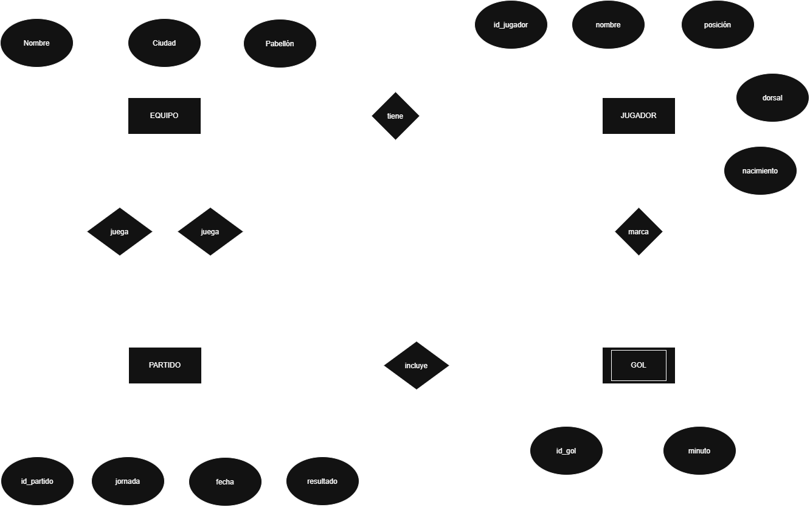
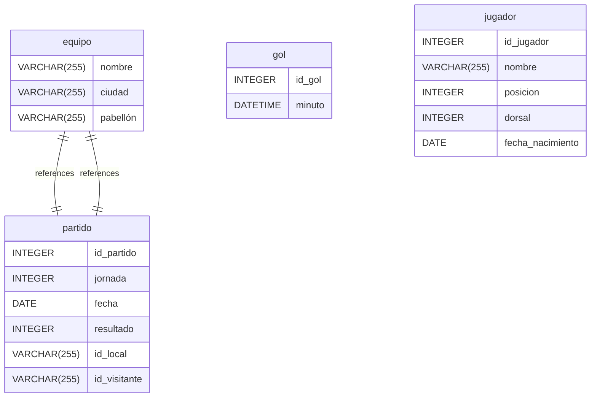

# GBD · Ejercicios E/R 5 · Liga de fútbol sala

Un enunciado completo, por equipos: hoy, del enunciado al E/R y a las tablas. El lunes esas tablas se
crean en MariaDB con DBeaver, se cargan los datos (os los da el profesor en CSV) y se contestan las
preguntas de abajo con SQL.

La teoría está en [`../teoria/teoria-2-er-y-relacional.md`](../teoria/teoria-2-er-y-relacional.md):
apartado 2.3 (notación), reglas de paso a tablas 1 a 11, y 1.6 (dato derivado).

## Enunciado

> Una liga aragonesa de fútbol sala tiene seis equipos. De cada equipo, nombre (no se repite),
> ciudad y pabellón. Cada jugador juega en un equipo; de él se guarda nombre, posición (portero,
> cierre, ala, pívot), dorsal y fecha de nacimiento. En un equipo no se repite el dorsal. Cada
> partido es de una jornada y una fecha, lo juegan un equipo local y uno visitante, y se guarda el
> resultado. De cada gol, quién lo marcó, en qué partido y en qué minuto.

## Preguntas que tiene que contestar la base de datos

El lunes se contestan en SQL. Hoy sirven para comprobar el diseño: cada una se tiene que poder
contestar recorriendo vuestras tablas.

1. ¿Qué equipos hay?
2. ¿Quiénes son los porteros?
3. ¿Cuáles son los cinco jugadores más jóvenes?
4. ¿En qué partidos de las jornadas 2 y 3 marcó el local 3 goles o más?
5. ¿Cuántos jugadores hay de cada posición?
6. Cada jugador, con el nombre de su equipo.
7. Los resultados de la jornada 1, con los nombres de los dos equipos.
8. Los cinco máximos goleadores.
9. ¿Qué equipos han marcado más de 12 goles en total?
10. ¿Qué jugadores de campo (los que no son porteros) no han marcado ningún gol?
11. La clasificación: 3 puntos por victoria y 1 por empate.

## Qué se hace hoy

| # | Qué | Cómo |
|---|---|---|
| A | El E/R | draw.io, notación de clase: entidades, relaciones, atributos, claves y cardinalidades `(mín,máx)` | 
| B | Las tablas | Notación de texto del apartado 2.3: `PK`, `FK → TABLA`, `?` para lo que admite nulo, `UK(…)` |
| C | La regla de cada clave ajena | Una línea por clave ajena: «`id_equipo` en JUGADOR: regla 2, JUGADOR tiene `(1,1)`» |
| D | Las preguntas | Para cada una: qué tablas miras y por qué columnas las enlazas |
| E | Restricciones que no caben | Lo que ni el E/R ni las tablas garantizan, y dónde se garantizaría |

Piensa:

- Un partido lo juegan **dos** equipos, y no son iguales: uno es local y otro visitante. ¿Cuántas
  relaciones hay entre PARTIDO y EQUIPO? ¿Cómo se llaman sus claves ajenas?
- «En un equipo no se repite el dorsal», pero en dos equipos distintos sí. ¿Qué clave alternativa
  lo garantiza?
- El resultado del partido, ¿se puede sacar de otra tabla? Si se puede, ¿lo guardáis o no? ¿Qué
  pasa si se guarda y no cuadra?
- ¿Qué impide que un equipo juegue contra sí mismo? ¿Y que marque un gol un jugador que no estaba en
  ninguno de los dos equipos del partido?

## Entrega

En la carpeta `bd/liga/` del repositorio de vuestro equipo: la imagen del E/R y un documento con las
partes B a E. El lunes se sigue desde ahí.

### A | El E/R



### B | Las tablas

```TEXT
EQUIPO(nombre PK, ciudad, pabellón)
PARTIDO(id_partido PK, jornada, fecha, resultado)
GOL(id_gol, minuto)
JUGADOR(id_jugador, nombre, posición, dorsal, fecha_nacimiento)
```

### C | Drawdb exportación SQL


### D | Crear tablas DBeaver