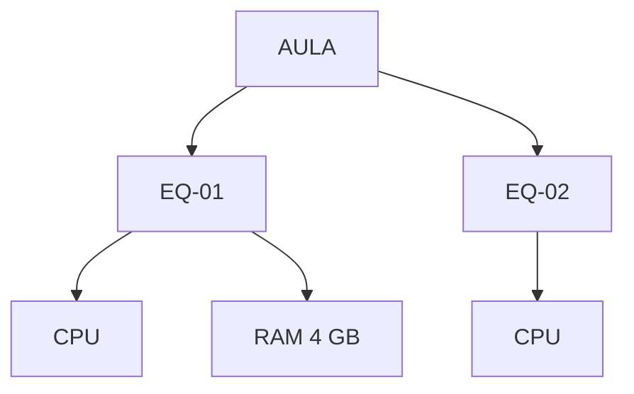
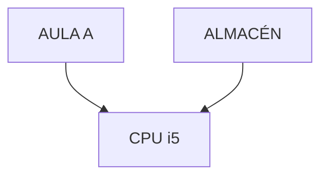

# RESUMEN
## 1.2 Entidades, atributos y valores
* Entidad: Objeto del mundo real. Ej: EQ-04
* Atributo: Propiedad de la entidad.
* Valor: Contenido concreto del atributo.
## 1.3 Entidad tipo y entidad instancia
* Entidad tipo: La clase genérica. Ej: equipo en general.
* Entidad instancia: Un objeto concreto. Ej: el equipo 0-4.
## 1.4 Tipo de datos y de dominio
* Tipo dato: Conjunto de valores con características comunes y con unas operaciones adimisibles. Ej: entero, decimal, cadena carácteres, etc.
* Dominio: Conjunto de valores válidos. Ej: 1, 2, 4, 6, 8, 10, 12, etc.
## 1.5 Valor nulo
Ausencia de valor.
## 1.6 Atributos identificadores y claves
* Atributo identificador: Valor único y no se repite entre instancias.
* Clave: Identifica las instancias.
> [!NOTE]
>
> Todo identificador es clave
>
> Clave puede necesitarios varios atributos identificadores.
## 1.7 Representación tabular y ficheros
Las bases de datos se representan como tablas (normalmente).

Dentro de la tabla:
* Fila: Entidad instancia.
* Columna: Atributo.
* Celda: Valor.
---
En ficheros de datos:
* Fila: Registro.
* Columna: Campo.
## 1.8 Ficheros de texto y fichero de datos
* FIcheros de texto: Carácteres legibles.
* Ficheros de datos: Bytes con el formato que decida el programa.
---
* CSV (Comma Separated Values): texto plano con un registro por línea y los campos separados por un carácter. 

EJ:
```csv
Equipo;Aula;Grupo;Placa;RAM;Obs.
EQ-01;1.12;G1;Asus P8H61-M LX;2x4GB DDR3 Kingston;
EQ-02;1.12;G1;Asus P8H61-M LX;"4GB DDR3 kingston; 2GB Samsung";ranura 3 rota
EQ-03;1.12;Grupo 2;ASUS P8H61-MLX;4096MB DDR3 KINGSTON;no arranca
```
## 1.9 Las Bases de datos
Una base de datos es un conjunto de ficheros interrelacionados.
## 1.10 Nivel lógico y nivel físico
* Lógico
    * Qué es: Tablas, campos, registros, interrelaciones.
    * Cuando: Siempre que se pueda: es lo más productivo.
* Físico
    * Qué es: Encadenamiento de registros, compresión, tipos de índice.
    * Cuando: Solo cuando hace falta optimizar.
## 3. Los SGBD
Un SGBD (Sistemas de Gestión de Bases de Datos) es el software cuya finalidad es la gestión de las bases de datos.
## 3.2
### Restricciones modelo y del usuario
* Restricciones modelo: inherente al modelo. Ej: dos filas no pueden tener la misma clave primaria.
* Restricciones del usuario: las decida el usuario. Ej: un componente retirado no puede estar montado en un equipo.
## Técnicas concurrencia
* Transacción: conjunto de operaciones que se ejecutan como una unidad.
* Bloqueo- impredir el acceso a ciertos datos mientras una transacción lo usa, para que las transacciones se ejecuten como si estuvieran aisladas.
## 3.3 
## 4. Modelos de bases de datos
Un modelo de datos es un conjunto de herramientas lógicas para:
* Describir los datos.
* Interrelaciones de datos.
* Restricciones a aplicar.
Todo modelo de datos aporta:
* Estructura de datos (tabla, árboles).
* Reglas de integridad.
* Operaciones (modificaciones como altas o bajas).
### Modelos más comunes
* Jerárquico

* Red: Lo mismo pero un mismo nodo puede tener más de un papito.

* Relacional: Un único elemento: la relación. Las interrelaciones se implementan con claves ajenas que apuntan a la clave primaria de otra tabla.
## 4.3
## 4.4 NO SQL (no relacional)
El mismo dato, «EQ-04 está en el Taller y tiene un módulo de 8 GB DDR4 Crucial», en tres modelos:
### Relacional
Tablas relacionadas por claves.

EJ:

#### Equipos
| id_equipo | aula |
| :--- | :--- |
| EQ-04 | Taller |

#### Componentes
| id_componente | id_equipo | tipo | fabricante | capacidad_gb |
| :--- | :--- | :--- | :--- | :--- |
| C-0117 | EQ-04 | RAM DDR4 | Crucial | 8 |
### Documental
Un documento JSON, en este caso, por equipo.

EJ:
```json
{
    "equipo": "EQ-04",
    "aula": "Taller",
    "componentes": [
        { "tipo": "RAM DDR4", "fabricante": "Crucial", "capacidad_gb": 8 }
    ]   
}
``` 
### Clave valor
Una clave y un valor, que el gestor no interpreta.

EJ:
```
equipo:EQ-04:aula → "Taller"
equipo:EQ-04:ram_gb → 8
```
### Las cuatro familias:

#### Documental
* Cómo guarda: Documento JSON.
* Para qué: Datos con estructura variable como en catálogos.
* Ej: MongoDB, CouchDB.
#### Clave - valor
* Cómo guarda: Pares clave > valor
* Para qué: Velocidad.
* Ej: Redis, Valkey.
#### Columnar
* Cómo guarda: Guarda los datos agrupados por columnas en lugar de por filas.
* Para qué: Escritura masiva.
* Ej: Cassandra, HBase.
#### Grafos
* Cómo guarda: nodos y aristas con propiedades.
* Para qué: Redes sociales/recomendaciones de feeds.
* Ejemplos: Neo4j.
### Comparativa relacional / No SQL (no relacional) 
* Esquema: Fijo / flexible.
* Integridad: Garantizados desde el gestor / Garantizado desde la aplicación.
* Transacciones: ACID / Depende, a veces se prioriza velocidad.
* Consulta: SQL estándar / Lenguaje propio del gestor.
* Escala: Mejor escala vertical (servidor grande) / Mejor escala horizontal (muchos servidores).
* Cuándo: Datos estructurados / Volumen enorme.
## 5. Ubicación bases de datos
## 5.1 Dónde está el gestor
### Embebida
* Cómo funciona: Bases de datos en la propia aplicación.
* Ej: SQLite en cada móvil Android.
### Cliente - servidor
* Cómo funciona: Un servidor atiende por procesos a muchos clientes.
* Ej: Maria DB en el aula.
### En la nube
* Cómo funciona: Un proveedor da el gestor como servicio
* Ej: Amazon RDS, Azure SQL, Google Cloud SQL, MongoDB Atlas.
## 5.2 Dónde están los datos
* Centralizada
    * Todos los datos en un único sitio.
    * Ej: MongoDB en un PC / servidor.
* Distribuida
    * Los datos se reparten en diferentes servidores pero el usuario lo ve igual que si estuvieran en el mismo sitio.
    * Una empresa con una sede en cada ciudad; cada sede guarda sus datos y se consultan juntos.
        * Fragmentada: Cada servidor guarda una parte distinta de la información.
        * Replicada: Varios servidores guardan una copia exacta de los mismos datos.
## 5.7
* Atomicidad: O se hacen todas las operaciones de la transacción, o ninguna
* Consistencia: Ejecutada aisladamente, la transacción conserva la consistencia de la BD
* Aislamiento: Con concurrencia, cada transacción se ejecuta como si las demás no hubieran empezado o ya hubieran terminado
* Durabilidad: Terminada con éxito, los cambios permanecen incluso ante fallos del sistema
## 6. Clasificación de los SGDB
Ejemplos: 
### María DB
* Modelo: Relacional.
* Licencia: Libre (GPL).
* Ubicación: Servidor.
* Consultas: SQL.
* Para qué: Alternativa libre respecto MySQL de Oracle.
### PostgreSQL
* Modelo: Objeto-relacional.
* Licencia: Libre (licencia PostgreSQL, tipo BSD).
* Ubicación: Servidor.
* Consultas: SQL.
* Para qué: Más completa de los libres.
### SQLite
* Modelo: Relacional.
* Licencia: Dominio público.
* Ubicación: Embebido.
* Consultas: SQL.
* Para qué: Gestor más instalado, el más simple.
### MongoDB
* Modelo: Documental.
* Licencia: SSPL, de código disponible, edición de pago.
* Ubicación: Servidor / nube (Alas).
* Consultas: Lenguaje propio.
* Para qué: Esquema flexible.
### Redis
* Modelo: Clave-valor.
* Licencia: Libre (AGPL). Bifurcación: Valkey.
* Ubicación: Servidor.
* Consulta: Comandos propios.
* Para qué: Muy rápido; normalmente utilizado como caché de otra BD.
### Oracle Database
* Modelo: Objeto-relacional.
* Licencia: Propietario; edición gratuita limitada.
* Ubicación: Servidor y nube.
* Consulta: SQL y PL/SQL.
* Para qué: Banca y grandes empresas.
### MySQL
* Modelo: Relacional.
* Licencia: Oracle, licencia gratuita comercial.
### Microsoft SQL Server
* Modelo: Relacional.
* Licencia: Propietario.
### Cassandra
* Modelo: Relacional.
* Licencia: Libre.
### Neo4j
* Modelo: Grafos.