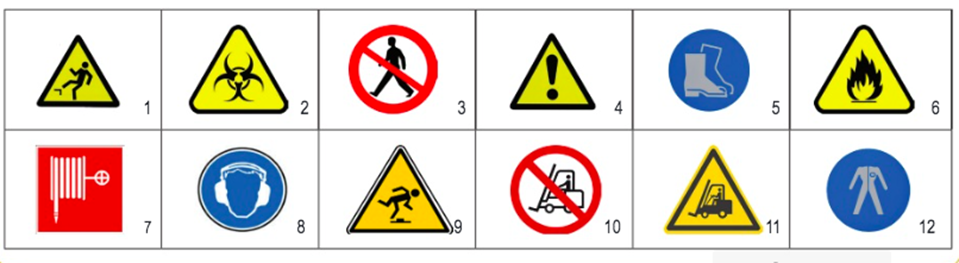

## Repaso Parte 1: Prevención de Riesgos Laborales

Preguntas con sus opciones y solucionario completo. La respuesta correcta aparece en verde con una marca.

## TEST

1. Desde el punto de vista de la prevención, para que exista un accidente de trabajo:

- a No se precisa que existan lesiones en las personas.

- b Cualquier acontecimiento no previsto, anormal, que interrumpa la actividad y que pueda llegar a ocasionar lesiones ya se considera accidente de trabajo.

- c Incluye también los incidentes donde no hay lesiones o daños.

- d **Todas son ciertas**. [CORRECTA]

Respuesta: d. Desde la prevención, el accidente incluye también los incidentes sin lesiones ni daños.

2. Un riesgo laboral es:

- a Cualquier característica del trabajo que puede influir en que aparezca un accidente.

- b Un peligro grave para el trabajador.

- c **La posibilidad de sufrir un daño causado por el trabajo**. [CORRECTA]

- d Todas son correctas.

Respuesta: c. Riesgo laboral = posibilidad de sufrir un daño derivado del trabajo.

3. La ergonomía:

- a Es adaptar el trabajo a la persona.

- b Es adaptar la persona al trabajo.

- c Trata de evitar la fatiga al trabajador.

- d **a y c son correctas**. [CORRECTA]

Respuesta: d. Adapta el trabajo a la persona y trata de evitar la fatiga.

4. La diferencia entre medidas de protección colectiva y medidas de prevención es que:

- a En primer lugar se aplican las de protección colectiva y después, una vez protegido, se aplican las de prevención.

- b Las de prevención se aplican sobre el foco, sobre el origen, y las de protección colectiva sobre el trabajador.

- c **Las de prevención se aplican sobre el foco, y después se aplican las de protección colectiva sobre el medio de transmisión.** [CORRECTA]

- d No existe diferencia entre ambas medidas.

Respuesta: c. La prevención actúa sobre el foco/origen; la protección colectiva, sobre el medio de transmisión.

5. No es una técnica de protección colectiva:

- a Las redes de seguridad.

- b **La higiene industrial**. [CORRECTA]

- c Los dispositivos de seguridad.

- d  La ventilación general.

Respuesta: b. La higiene industrial es una técnica preventiva, no de protección colectiva.

6. Si realizo una tarea por debajo de mi titulación se puede dar:

- a  Fatiga profesional.

- b  Enfermedad profesional.

- c  Accidente de trabajo.

- d  **Insatisfacción laboral**. [CORRECTA]

Respuesta: d. Trabajar por debajo de la titulación genera insatisfacción laboral.

7. El accidente in itinere:

- a  Se produce en el camino de casa al trabajo, o a la inversa.

- b  Hay sentencias que reconocen este accidente por haberte desviado de tu recorrido habitual un momento.

- c  Ha de ser en el recorrido habitual.

- d  **Todas son correctas**. [CORRECTA]

Respuesta: d. Todas son correctas.

8. Se considera lugar de trabajo:

- a  Las áreas del centro de trabajo, edificadas o no.

- b  Las áreas del centro de trabajo edificadas.

- c  Se incluyen los locales, pasillos, escaleras, vías de circulación, comedores y zonas de descanso, entre otros.

- d  **a y c son correctas**. [CORRECTA]

Respuesta: d. Áreas del centro de trabajo, edificadas o no, que incluyen pasillos, escaleras, comedores, etc.

9. Entre las medidas de prevención:

- a  **Los locales deben tener 3 metros de altura y las oficinas 2,5 metros**. [CORRECTA]

- b  Las puertas de emergencia permanecerán cerradas.

- c  Las escaleras se protegerán con barandillas de 80 cm. de alto.

- d  Todas son correctas.

Respuesta: a. Solo la a es correcta: las puertas de emergencia no pueden estar cerradas y las barandillas son de 90 cm.

10. Un ambiente térmico confortable se caracteriza por los siguientes valores:

- a  Trabajos ligeros: 17 a 27 °C.

- b  Trabajos sedentarios: 14 a 25 °C.

- c  Ambas son correctas.

- d  **Ambas son falsas**. [CORRECTA]

Respuesta: d. Están intercambiados: sedentarios 17 a 27 °C y ligeros 14 a 25 °C.

11. ¿Qué tipo de radiaciones son los rayos X y los rayos gamma? Y ¿los microondas o salas de soldadura?

- a  **Ionizantes y no ionizantes, respectivamente**. [CORRECTA]

- b  No ionizantes e ionizantes, respectivamente.

Respuesta: a. Rayos X y gamma son ionizantes; microondas y soldadura son no ionizantes.

12. Condiciones adecuadas de iluminación:

- a  Es preferible la iluminación natural a la artificial.

- b  La iluminación artificial complementa a la natural.

- c  Todos los lugares de trabajo contarán con luces de emergencia.

- d  **Todas son correctas**. [CORRECTA]

Respuesta: d. Todas son correctas.

13. En la estimación del riesgo, ¿qué aspecto/s se estudian?:

- a  Probabilidad de que se produzca el daño.

- b  La severidad de sus consecuencias.

- c  El número de trabajadores expuestos y el tiempo de exposición.

- d  **Todas son correctas**. [CORRECTA]

Respuesta: d. Se estudian probabilidad, severidad, trabajadores expuestos y tiempo de exposición.

14. Los riesgos del uso de herramientas provienen de:

- a  El abandono en lugares peligrosos.

- b  La falta de mantenimiento y revisión.

- c  Transporte inadecuado de las mismas.

- d  **Todas son ciertas**. [CORRECTA]

Respuesta: d. Todas son ciertas.

15. Indica qué nivel de prioridad (1, 2, 3 y 4) tiene cada riesgo indicado, siendo la primera la de mayor riesgo.

- a Riesgo tolerable: **Prioridad 3**

- b Riesgo importante: **Prioridad 1**

- c Riesgo moderado: **Prioridad 2**

- d Riesgo trivial: **Prioridad 4**

Orden de mayor a menor riesgo: importante, moderado, tolerable, trivial.

16. Los efectos sobre el cuerpo del paso de la electricidad dependen de los siguientes factores:

- a Nivel de intensidad.

- b La trayectoria que sigue.

- c El tiempo del contacto.

- d **Todas son correctas**. [CORRECTA]

Respuesta: d. Intensidad, trayectoria y tiempo de contacto.

17. Rellena los huecos: Los efectos que pueden provocar los agentes químicos dependen del tipo de __________, de su ___________ y del tiempo de _________.

- a gravedad, naturaleza y exposición.

- b **contaminante, concentración y exposición**. [CORRECTA]

- c contagio, agresividad y exposición.

- d No depende de nada.

Respuesta: b. Contaminante, concentración y exposición.

18. Ejemplos de contacto eléctrico directo e indirecto en el siguiente ejemplo, son los siguientes:

- a Tocar una lavadora y una tv conectadas a la corriente, respectivamente.

- b Tocar un aparato de aire acondicionado y un frigorífico, respectivamente.

- c **Tocar un cable pelado y tocar una radial, respectivamente**. [CORRECTA]

- d Es lo mismo, no hay diferencia.

Respuesta: c. Directo: cable pelado (parte activa). Indirecto: radial (masa con tensión accidental).

19. Un extintor del tipo polvo ABC nos indica:

- a Es un extintor válido para apagar metales.

- b Es un extintor válido solo para líquidos como el aceite.

- c Es un extintor válido para instalaciones eléctricas.

- d **Es un extintor válido para sólidos, líquidos y gases**. [CORRECTA]

Respuesta: d. El polvo ABC sirve para sólidos, líquidos y gases.

20. Un trabajador no alcanza el nivel de ventas exigido. ¿Qué le puede generar esta situación? 

- a **Estrés**. [CORRECTA]

- b Fatiga profesional.

- c Insatisfacción laboral.

- d Acoso.

Respuesta: a. No alcanzar los objetivos de ventas genera estrés.

## CASOS PRÁCTICOS

## A. Modalidades organizativas

A un servicio de prevención ajeno le llegan las siguientes empresas consultando qué modalidad organizativa sería más adecuada. Señala cuál le corresponde y por qué.

| Empresa | Modalidad y motivo |
| --- | --- |
| Una tienda de ropa con 20 trabajadores donde el empresario tiene la formación básica y está todo el día en la tienda.| **Asunción personal por el empresario**. Menos de 25 trabajadores en un único centro, sin actividades del Anexo I, con formación básica y presencia habitual en el centro.|
| Un supermercado con 590 trabajadores | **Servicio de prevención propio**. Obligatorio con más de 500 trabajadores.|
| Varias empresas de un pequeño polígono que quieren asumir entre todas ellas conjuntamente la prevención.|**Servicio de prevención mancomunado**. Varias empresas comparten la prevención.|
| Una con 260 trabajadores que desarrolla una actividad del anexo I del RD 39/1997 (actividades peligrosas).|**Servicio de prevención propio**. Obligatorio con más de 250 trabajadores, o más de 50 si hay actividad peligrosa del Anexo I.|

## B. Identifica las siguientes señales

| Nº | Señal |
| --- | --- |
| 1 | Peligro: caídas a distinto nivel |
| 2 | Peligro: riesgo biológico |
| 3 | Prohibido el paso a peatones |
| 4 | Peligro en general |
| 5 | Calzado de protección obligatorio |
| 6 | Peligro: materias inflamables |
| 7 | Boca de incendio (manguera) |
| 8 | Protección obligatoria del oído |
| 9 | Peligro: tropezar (obstáculos en el suelo) |
| 10 | Prohibido el paso a carretillas de manutención |
| 11 | Peligro: carretillas de manutención |
| 12 | Protección obligatoria del cuerpo (ropa de protección) |

## C. Polvo en suspensión en la cerámica

Pedro trabaja en una empresa de cerámica donde se produce polvo en suspensión. Relaciona las letras con los números y establece el orden.

- a Entrega de mascarillas a trabajadores: 3, protección individual.

- b Utiliza aspiradores de polvo en los lugares de trabajo: 2, protección colectiva.

- c Sustituye el cloro por el oxígeno que es menos perjudicial: 1, prevención (actúa en el origen).

Orden de utilización: primero c (1, prevención), después b (2, colectiva) y por último a (3, individual).

## D. Fuego

#### a Indica cuáles son los tres elementos del triángulo del fuego y explica qué elemento está presente en este caso.

Combustible, comburente (oxígeno) y energía de activación (calor). En este caso el combustible son los cables, plásticos o el producto inflamable; el comburente es el oxígeno del aire, siempre presente; y el foco de calor suele ser un cortocircuito o sobrecarga, que es lo que normalmente inicia el fuego.

#### b ¿Qué tipo de fuego podría producirse si arden los cables y componentes eléctricos? ¿Y si arde un producto de limpieza inflamable?

Cables y componentes eléctricos: fuego de origen eléctrico (al ser sólidos, también se trata como clase A, con el riesgo añadido de la electricidad. Producto de limpieza inflamable: clase B (líquidos inflamables).

#### c ¿Qué tipo de extintor sería el más adecuado para intervenir sobre un fuego en un equipo eléctrico que continúa conectado a la corriente? Justifica tu respuesta.

CO2 (nieve carbónica). No conduce la electricidad, no deja residuo y no daña el equipo. El polvo ABC también sirve, pero ensucia y estropea los componentes. Nunca agua. Lo ideal es cortar antes la corriente.

#### d Explica brevemente cómo se debe utilizar un extintor portátil, indicando al menos tres pasos.

- Descolgarlo y quitar el precinto o pasador de seguridad.

- Acercarse con el viento a la espalda y dirigir la boquilla a la base de las llamas.

- Apretar la palanca y barrer en zigzag de forma continua.

- No dar la espalda al fuego y vigilar que no se reavive.

#### e Si el incendio comienza a extenderse y no se puede controlar con seguridad, ¿qué debe hacer el trabajador?

- No intentar apagarlo. Dar la alarma y avisar al 112 y al responsable.

- Evacuar por las rutas de emergencia, siguiendo la señalización y sin usar ascensores.

- Cerrar puertas y ventanas al salir si es posible, sin poner en riesgo a nadie.

- Ir al punto de reunión y no volver hasta que lo autoricen.
