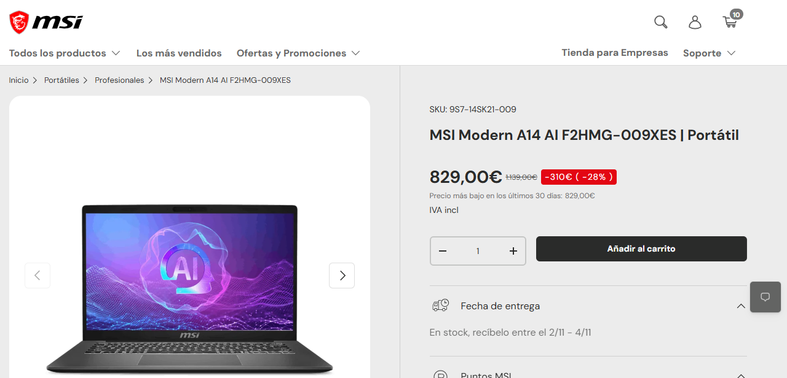
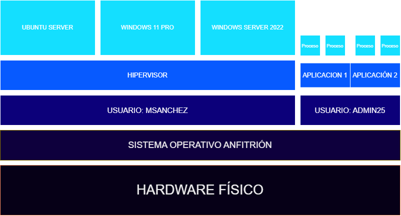
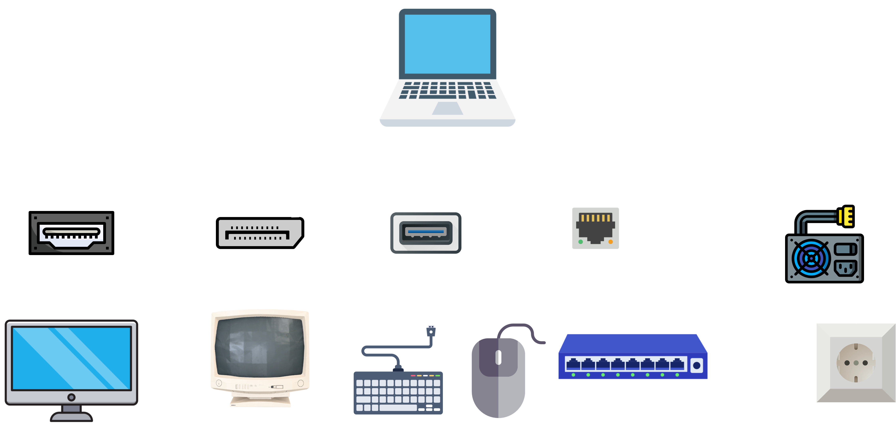
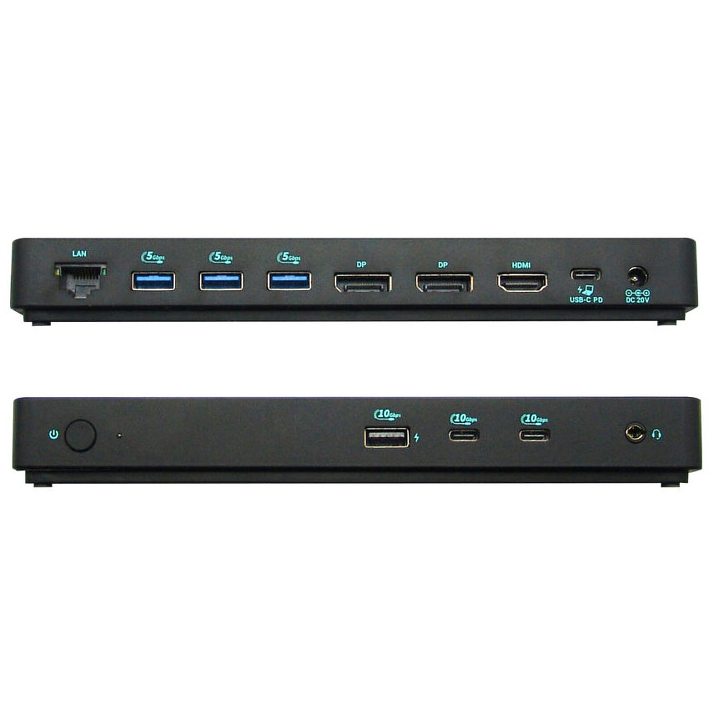

https://es-store.msi.com/products/modern-a14-ai-f2hmg-009xes-portatiles

https://www.energystar.gov/productfinder/product/certified-computers/details/4478547

https://knowledge.broadcom.com/external/article?legacyId=80807

Iván Gimeno Montoya
# Actividades
## Actividad 1. Analizar necesidades y componentes
### 1. Identificad CPU, RAM, SSD, GPU, placa base e interfaces de entrada/salida. Explicad su función y qué características importan para este encargo.

- **CPU**
    * **Modelo**: AMD Ryzen™ 7 250 (8 cores, Max Boost Clock 3.3 GHz)
    * **Función**: Es el cerebro del ordenador; se encarga de procesar las instrucciones del sistema operativo, aplicaciones y tareas en segundo plano.
    * **Características importantes**: Sus 8 núcleos aportan una excelente capacidad multitarea, permitiendo ejecutar aplicaciones de ofimática avanzada, navegación pesada y software profesional de forma fluida.

- **RAM**
    * **Modelo**: 32 GB (16 GB * 2) DDR5
    * **Función**: Memoria de acceso aleatorio donde se cargan de forma temporal los datos de los programas y archivos que estás usando activamente para un acceso ultra rápido.
    * **Características importantes**: La capacidad de 32 GB en doble canal (*dual-channel*) es ideal para mantener decenas de pestañas abiertas, máquinas virtuales o programas pesados sin ralentizaciones.

- **SSD**
    * **Modelo**: 1 TB NVMe SSD PCIe Gen4
    * **Función**: Almacenamiento permanente de alta velocidad para el sistema operativo, programas y archivos personales.
    * **Características importantes**: Al ser NVMe PCIe Gen4, ofrece tasas de lectura y escritura sumamente rápidas (arranque del sistema en pocos segundos y transferencia de archivos instantánea). 

- **GPU**
    * **Modelo**: AMD Radeon™ Graphics (Integrada)
    * **Función**: Procesador gráfico encargado de renderizar la interfaz visual, vídeos y gráficos en pantalla.
    * **Características importantes**: Al estar integrada en el procesador, comparte memoria con la RAM. Es perfecta para tareas multimedia de alta definición, reproducción de vídeo 4K y ofimática, ahorrando batería frente a gráficas dedicadas.

- **Placa base**
    * **Modelo**: Propietaria de MSI (Chipset SoC integrado / Serie MS-14SK)
    * **Función**: El circuito impreso principal que conecta físicamente todos los componentes del portátil (CPU, RAM, almacenamiento y puertos) permitiendo su comunicación.
    * **Características importantes**: Su diseño compacto está optimizado para el chasis ultrafino de 14 pulgadas del portátil, integrando conectividad moderna como Wi-Fi 6E y controladoras de alta velocidad.

- **Interfaces de entrada/salida (I/O)**
    * **Modelo**: 
      * 2x USB Type-C (USB3.2 Gen2 / DisplayPort™ / Power Delivery 3.0)
      * 2x USB Type-A USB3.2 Gen1
      * 1x HDMI™ 2.1 (4K @ 60Hz)
      * 1x Mic-in/Headphone-out Combo Jack
      * 1x Lector de tarjetas microSD
    * **Función**: Conectar periféricos externos, pantallas adicionales, dispositivos de audio y transferencia de datos.
    * **Características importantes**: Los puertos USB-C con Power Delivery y DisplayPort aportan una gran versatilidad (permiten cargar el portátil y conectar monitores externos con un solo cable), mientras que el HDMI 2.1 garantiza salida de vídeo fluida a pantallas 4K.

### 2. Explicad las diferencias entre núcleos físicos, hilos lógicos y arquitectura x86-64/ARM. Justificad la elección de arquitectura.

#### Diferencias entre núcleos físicos e hilos lógicos

* **Núcleo físico (Physical Core)**: 

    * Es la unidad de procesamiento de hardware real dentro del silicio de la CPU. Dispone de sus propias unidades aritmético-lógicas (ALU), registros, unidad de punto flotante (FPU) y cachés de nivel 1 y 2 (L1/L2). Ejecuta instrucciones de forma totalmente independiente e simultánea a nivel físico.

* **Hilo lógico** (Logical Thread / SMT / Hyper-Threading): 

    * Es una subdivisión virtual gestionada por el procesador que permite a un único núcleo físico presentar dos procesadores lógicos al sistema operativo. Aprovecha los tiempos muertos en los que el núcleo físico espera datos de la memoria RAM para procesar una segunda secuencia de instrucciones.

**Impacto práctico**: Un procesador de 8 núcleos físicos con SMT (Simultaneous Multithreading) muestra 16 hilos lógicos al sistema operativo, ofreciendo entre un 15% y un 30% más de rendimiento en tareas multihilo paralelas (compilación de código, renderizado, cálculo distribuido) respecto a un procesador sin SMT.

#### Arquitectura x86-64 vs. ARM

* **x86-64** (CISC - Complex Instruction Set Computer):

    * **Diseño**: Utiliza instrucciones de longitud variable y alta complejidad, capaces de ejecutar múltiples operaciones internas en una sola orden.

    * **Ecosistema**: Desarrollado por Intel y AMD. Es el estándar dominante en ordenadores de sobremesa, portátiles tradicionales y servidores.

    * **Filosofía**: Prioriza el rendimiento bruto por ciclo de reloj y la compatibilidad retrospectiva con décadas de software, a costa de una mayor complejidad de silicio y un consumo térmico/eléctrico superior.

* **ARM** (RISC - Reduced Instruction Set Computer):

    * Diseño: Utiliza un conjunto de instrucciones simplificado y de longitud fija. Cada instrucción realiza una tarea sencilla que se ejecuta rápidamente en pocos ciclos de reloj.

    * Ecosistema: Diseñada por ARM Ltd. y licenciada a fabricantes como Apple (Apple Silicon), Qualcomm (Snapdragon) o MediaTek.

    * Filosofía: Prioriza la eficiencia energética por vatio, ofreciendo menor consumo eléctrico, menor emisión de calor y mayor duración de batería en dispositivos móviles y ultrabooks.

#### Justificación de la elección de x86-64 para tus requisitos

Para el perfil de portátil buscado (1.000–1.300 €, 32 GB ampliables a 64 GB, dual boot Windows 11 + Ubuntu y 2 monitores externos), la arquitectura x86-64 es la única opción que cumple íntegramente las especificaciones por las siguientes razones:

1. Ampliación de memoria RAM por módulos (SODIMM):

    * En ARM para portátiles (Snapdragon X Elite, Apple Silicon), la RAM está soldada en placa o integrada directamente dentro del encapsulado del SoC para obtener el máximo ancho de banda. Es imposible comprar un equipo con 32 GB y ampliarlo a 64 GB en el futuro.

    * En x86-64 (Intel Core / AMD Ryzen), los portátiles de gama profesional (como Lenovo ThinkPad E14 o HP ProBook) siguen ofreciendo 2 ranuras SODIMM físicas sustituibles.

2. Compatibilidad nativa y madurez en Linux (Ubuntu):

    * La arquitectura x86-64 lleva más de dos décadas con soporte de primer nivel en el kernel de Linux. Los controladores gráficos de la GPU integrada, la gestión de suspensión (suspend-to-RAM), el control térmico y el Wi-Fi funcionan de forma estable desde la instalación.

    * Los portátiles ARM en el mercado de consumo aún enfrentan serias limitaciones de controladores en distribuciones Linux convencionales (problemas con salidas de vídeo DisplayPort, aceleración gráfica por GPU o administración de energía).

3. Ejecución nativa de binarios sin emulación:

    * En x86-64, todo el entorno de desarrollo, contenedores Docker/Podman, máquinas virtuales (KVM, VirtualBox) y software técnico se ejecuta nativamente a máxima velocidad.

    * En ARM, aunque existen capas de traducción de instrucciones (como Prism en Windows 11), las herramientas de virtualización de bajo nivel y aplicaciones no adaptadas sufren caídas de rendimiento o incompatibilidades directas.

4. Gestión multimonitor nativa:

    * Las GPU integradas de AMD e Intel actuales en x86-64 (Radeon 780M / Intel Arc) soportan de forma nativa hasta 3 o 4 pantallas independientes mediante el control de bus DisplayPort/HDMI directo, asegurando que ambos monitores externos funcionen sin depender de controladores USB de terceros (como DisplayLink).

### 3. Explicad por qué importan la ampliación de RAM y SSD, la refrigeración, el consumo y el ruido.

#### 1. Ampliación de RAM y SSD: Longevidad y relación coste-rendimiento
* Ampliación de RAM y SSD
    * La posibilidad de ampliar la memoria RAM mediante módulos físicos SODIMM garantiza la longevidad del equipo frente a las exigencias crecientes del software, máquinas virtuales y contenedores, evitando tener que reemplazar el portátil cuando los 32 GB queden cortos. Ampliar a 64 GB de forma manual en el futuro resulta significativamente más económico que pagar el sobreprecio de la memoria soldada de fábrica. Por su parte, un SSD NVMe M.2 sustituible es imprescindible para mantener un arranque dual limpio entre Windows 11 y Ubuntu con espacio suficiente para ambos, garantizando además una reparación rápida ante fallos o desgaste de las celdas de memoria sin inutilizar la placa base.

* Refrigeración

    * Un sistema de disipación bien dimensionado evita el estrangulamiento térmico (thermal throttling), situación en la que el procesador reduce automáticamente sus frecuencias de reloj al alcanzar temperaturas límite cercanas a los $95^\circ\text{C}$. Un equipo con refrigeración deficiente pierde entre un 20% y un 40% de su potencia real a los pocos minutos de ejecutar tareas intensivas como compilaciones o renderizados, mientras que una disipación eficiente sostiene el rendimiento máximo de forma continuada. Mantener temperaturas bajas también frena la degradación de la batería de litio y de los componentes de la placa base, además de evitar la transferencia de calor al teclado.

* Consumo eléctrico

    * La eficiencia energética del procesador determina la autonomía real y la portabilidad del equipo. Un consumo reducido en reposo o en tareas ligeras extiende la duración de la batería durante la jornada laboral y disminuye el desgaste por ciclos diarios de carga. Adicionalmente, procesadores con consumos ajustados de 15 W a 28 W permiten operar a pleno rendimiento utilizando cargadores compactos y ligeros con tecnología USB-C Power Delivery de 65 W, evitando la necesidad de transportar cargadores pesados o propietarios.

* Ruido de ventilación

    * El perfil sonoro del sistema de refrigeración influye en la concentración y la fatiga cognitiva durante jornadas de trabajo prolongadas. Los ventiladores pequeños a altas revoluciones generan silbidos agudos altamente molestos, mientras que un sistema térmico amplio con palas de mayor tamaño mueve un volumen de aire equivalente produciendo un soplido grave y discreto. Una curva de ventilación optimizada en el firmware permite que el equipo funcione en modo completamente silencioso durante la navegación o edición de texto, activando los ventiladores progresivamente solo bajo cargas altas.
### 4. Diferenciad los requisitos imprescindibles de los deseables y justificad vuestra clasificación.

| Aspecto | Requisito |Imprescindible / deseable|
| --- | --- | --- |
| **Procesador** | Intel o AMD, arquitectura x86-64 | Imprescindible, si no se cumple este requisito no podemos utilizar el software deseado. |
| **RAM** | 32 GB como mínimo; se valora ampliación a 64 GB | Imprescindible 32 GB para soportar las máquinas virtuales. Los 64 GB son deseables para los próximos años, pero ahora no interesan por el aumento de precio.  |
| **Disco** | SSD NVMe de 1 TB como mínimo; preferiblemente sustituible | Imprescindible 1 TB para soportar las máquinas virtuales y otros prograams. Más de 1 TB sería deseable para los próximos años, pero ahora no interesan por el aumento de precio. |
| **Pantalla** | 14 pulgadas; preferentemente 1920 × 1200 o superior | Tanto las 14 pulgadas como la resolución son requisitos deseables por motivos de portabilidad y comodidad, pero no son imprescindibles para trabajar. |
| **Gráfica** | Integrada suficiente | Es imprescindible que el ordenador pueda manejar gráficos, pero no es necesario que tenga una gráfica dedicada. |
| **Pantallas simultáneas** | Pantalla integrada y dos monitores externos independientes | Deseable porque no es imprescindible para realizaer nuestro trabajo, pero sí es más comodo para trabajar. |
| **Puertos** | USB-A, HDMI y USB-C con salida de vídeo | No es impresicindible para el trabajo, pero sí es un requisito muy deseable y fácil de cumplir. |
| **Red** | Wi-Fi moderno y Ethernet integrado o por adaptador/dock | La Wi-Fi es imprescindible para trabajar actualmente, el Ethernet es muy desable y relativamente fácil de cumplir en modelos deseables. |
| **Movilidad** | Preferentemente 1,2–1,5 kg | Deseable la portabilidad y la movilidad, pero no es imprescindible para trabajar. |
| **Sistemas operativos** | Compatible con Windows 11 y Ubuntu | Imprescindible para el uso que se le va a dar. |
| **Teclado** | Español | Imprescindible para trabajar en entornos hispanohablantes. |
| **Otros** | Buena refrigeración, poco ruido, construcción duradera y garantía | Deseables y elementos que permiten dirimir el portátil más adecuado. |

## Actividad 2. Dimensionar cuatro máquinas virtuales

El profesorado puede necesitar estas máquinas **funcionando simultáneamente**:

|VM|Sistema operativo invitado|RAM asignada|
|-|-|-|
|1|Windows 11|8 GB|
|2|Ubuntu Desktop|4 GB|
|3|Ubuntu Server|2 GB|
|4|Windows 11|8 GB|

### 1. Calculad la RAM total asignada a las VM y la que queda para el anfitrión con 32 y 64 GB de RAM. Indicad si la memoria restante es suficiente y justificadlo.

Para calcular la memoria restante debemos de sumar los siguiente datos (aproximados):

* Windows 11 base: 6 GB
* VirtualBox + vmmem (virtualización): 1 GB
* RAM total máquinas host: 20 GB

Por tanto el consumo total son 27 GB. 

Memoria restante para cada configuración:

* Equipo 32 GB: 5 GB restantes.
    * ¿Son suficientes?: Dependerá de qué otros programas mantengamos abiertos. Dos escenarios y valores estimados de memoria:
        * Ningun programa abierto o muy ligero: con 5 GB restantes es más que suficiente.
        * Navegador Chromium (2GB), VS Code (0,5 GB), otros programas pesados como AutoCAD (2 GB) o Cisco Packet Tracer (0,5 GB): podría empezar a quedarse corto.
* Equipo 64 GB: 37 GB restantes
    * ¿Son suficientes?: Sí, de forma sobrada. Tanto para el sistema principal como para las máquinas virtuales y demás software habitual (VMware, Visual Studio, Cisco
Packet Tracer) es más que suficiente.

### 2. Proponed cuántas vCPU asignaríais a cada VM. Explicad qué problemas puede generar asignar demasiadas.

#### A. Propuesta de asignación de vCPU por Máquina Virtual
* **VM 1 (Windows 11 - 8 GB RAM):** **4 vCPUs** (Suficiente para mover el entorno gráfico de Windows de forma fluida).
* **VM 2 (Ubuntu Desktop - 4 GB RAM):** **2 vCPUs** (Adecuado para un escritorio Linux ligero).
* **VM 3 (Ubuntu Server - 2 GB RAM):** **1 o 2 vCPUs** (Ideal para servicios de red y consola sin interfaz gráfica).
* **VM 4 (Windows 11 - 8 GB RAM):** **4 vCPUs** (Igual que la primera para equilibrar cargas).
* **Total asignado:** Entre **11 y 12 vCPUs**. Los hilos restantes (4 a 5 hilos) quedan reservados exclusivamente para el anfitrión y el hipervisor.

#### B. Problemas que genera asignar demasiadas vCPU
1. **Problemas de planificación (*Co-scheduling*):** Si asignas más hilos de los que el procesador físico tiene disponibles (por ejemplo, intentar dar 8 vCPUs a cada Windows 11 sumando más de 16 hilos en total), el hipervisor tendrá que pausar constantemente los procesos esperando a que queden núcleos libres, generando una latencia enorme (*CPU throttling* virtual).
2. **Inestabilidad del Anfitrión (*Starvation*):** Si las VMs acaparan todos los hilos físicos, el sistema anfitrión se quedará sin capacidad de procesamiento para gestionar el disco, la red o la interfaz gráfica, provocando bloqueos y tirones (*stuttering*).
3. **Sobrecarga del Hipervisor:** Gestionar un exceso de cambios de contexto entre hilos virtuales consume ciclos de CPU útiles, restando rendimiento general al equipo.

### 3. Repartid 1 TB de almacenamiento entre el anfitrión, aplicaciones, archivos, discos virtuales y espacio libre. Indicad las capacidades en una tabla.

|ANFITRIÓN|APLICACIONES|ARCHIVOS|DISCOS VIRTUALES|ESPACIO LIBRE
|-|-|-|-|-|
|100 GB|60 GB|300 GB|80 GB + 50 GB + 50 GB + 80 GB = 260 GB GB|280 GB|

### 4. Valorad el comportamiento esperado durante el uso simultáneo de las cuatro VM.

**Gestión de memoria RAM en el MSI Modern A14**

El equipo viene configurado de fábrica con 32 GB de RAM DDR5, lo que te permite asignar unos 5 GB a cada una de las cuatro máquinas virtuales y mantener unos 12 GB libres para el sistema operativo anfitrión. Sin embargo, debido a que la placa base fija el límite máximo en 32 GB sin posibilidad de ampliar a 64 GB, no dispondrás de margen de maniobra si en el futuro necesitas virtualizar sistemas más exigentes. Si mantienes las máquinas en entornos moderados el comportamiento será fluido, pero si ejecutas cuatro máquinas virtuales pesadas de forma simultánea, la RAM se saturará y el sistema recurrirá al archivo de paginación (swap), reduciendo la agilidad general.

**Procesamiento y planificación de CPU con el procesador AMD Ryzen 7**

El procesador AMD Ryzen 7 (arquitectura x86-64 con 8 núcleos físicos y 16 hilos lógicos) integrado en este portátil gestiona la carga de las cuatro máquinas virtuales con solvencia, permitiendo asignar entre 2 y 4 vCPUs a cada una. La sobrecarga del hipervisor por hardware AMD-V es imperceptible y la CPU repartirá las tareas sin crear cuellos de botella, respondiendo con fluidez excepto en los momentos puntuales en los que las cuatro instancias ejecuten procesos de compilación o cálculo pesado al mismo tiempo.

**Rendimiento del almacenamiento NVMe SSD**

El SSD M.2 de 1 TB con bus PCIe 4.0 que incluye este modelo ofrece un ancho de banda y una tasa de operaciones por segundo (IOPS) elevadas. Esto garantiza que la lectura y escritura simultánea sobre los cuatro archivos de disco virtual no bloquee la entrada y salida de datos (I/O wait), permitiendo un arranque rápido de las máquinas virtuales y una buena velocidad al mover archivos grandes. Además, al ser un módulo M.2 estándar, podrás reemplazarlo fácilmente por una unidad de 2 TB o 4 TB en el futuro si las imágenes virtuales ocupan demasiado espacio.

**Comportamiento térmico y ruido en este chasis**

Al tratarse de un chasis ligero de 14 pulgadas con un sistema de disipación compacto, la carga continua de cuatro máquinas virtuales mantendrá al procesador trabajando a un ritmo constante. Esto provocará que el ventilador interno funcione a revoluciones medias o altas para estabilizar las temperaturas, generando un soplido constante y claramente audible durante las sesiones de trabajo. El procesador regulará sus frecuencias para evitar el estrangulamiento térmico (thermal throttling), pero la zona inferior de la carcasa alcanzará temperaturas más elevadas que en modelos profesionales con doble ventilación.

**Optimización según el sistema operativo base**

Al comercializarse con FreeDOS, la elección del sistema anfitrión que instales determinará la eficiencia del portátil. Si instalas Ubuntu Linux como sistema base utilizando KVM / QEMU, se activará la función de deduplicación de memoria (Kernel Samepage Merging), lo que reducirá la huella de RAM de las cuatro máquinas virtuales y compensará en parte la imposibilidad de ampliar la memoria a 64 GB. Si optas por Windows 11 como sistema anfitrión con VirtualBox o Hyper-V, el propio sistema consumirá más recursos de base, dejando un margen de RAM más justo.

## Actividad 3. Analizar los sistemas operativos

### 1. Dibujad un esquema funcional que relacione hardware físico, sistema operativo anfitrión, hipervisor, sistemas invitados, aplicaciones y usuarios. Explicad la función de cada elemento.

### 2. Comparad versiones concretas de Windows 11 y Ubuntu Desktop en: arquitectura, requisitos mínimos y recomendados, licencia, coste, compatibilidad con aplicaciones y virtualización, ventajas e inconvenientes.

| Característica | Windows 11 (24H2 / Home & Pro) | Ubuntu Desktop (24.04 LTS - Noble Numbat) |
| :--- | :--- | :--- |
| **Arquitectura** | • **x86-64** (requiere extensión POPCNT / SSE4.2)   • **ARM64** (dispositivos Copilot+ / Snapdragon) | • **x86-64 (amd64)**   • **ARM64** (Raspberry Pi, Apple Silicon via VM)   • RISC-V, s390x, ppc64el |
| **Requisitos Mínimos** | • CPU: 1 GHz 2+ núcleos de 64 bits compatibles   • RAM: 4 GB   • Disco: 64 GB   • Seguridad: TPM 2.0 y UEFI con Secure Boot   • GPU: DirectX 12 / WDDM 2.0 | • CPU: 2 GHz Dual-Core de 64 bits   • RAM: 4 GB   • Disco: 25 GB   • Seguridad: Compatible con Secure Boot (sin necesidad de TPM)   • GPU: Resolución 1024x768 |
| **Requisitos Recomendados** | • CPU: 4+ núcleos (Intel Gen 12+ / AMD Ryzen 5000+)   • RAM: 16 GB+   • Disco: 256 GB NVMe SSD | • CPU: 4+ núcleos a 2.5 GHz   • RAM: 8 GB–16 GB   • Disco: 80 GB+ NVMe SSD |
| **Licencia** | **Propietaria / EULA** de Microsoft | **Código Abierto** (GPL y otras licencias FOSS) |
| **Coste** | • Gratuito si actualizas desde Win 10 / Win 11 previa   • OEM / Retail: ~145 € (Home) / ~259 € (Pro) | **100% Gratuito** (Uso comercial y personal sin coste) |
| **Compatibilidad con Aplicaciones** | • Nativa para todo el software comercial (MS Office, Adobe Creative Cloud, AutoCAD)   • Excelente para videojuegos (DirectX 12, Anti-Cheats propietarios) | • Soporta software nativo Linux, paquetes Snap, Flatpak, AppImage   • Vía **Wine / Proton** ejecuta la gran mayoría de juegos de Steam y ejecutables `.exe`   • **Incompatible** con software con anticheats a nivel de kernel (Valorant, Fortnite) o suite Adobe nativa |
| **Virtualización** | • **Hyper-V** (Nativo en versión Pro)   • Windows Sandbox y WSL2 (Subsistema de Linux)   • Compatible con VMware Workstation, VirtualBox | • **KVM / QEMU / libvirt** (Hypervisor nativo de alto rendimiento)   • LXD / Docker (Contenedores nativos)   • Compatible con VirtualBox, VMware Workstation |
| **Ventajas** | 1. Máxima compatibilidad con programas de diseño, edición y juegos.   2. Excelente soporte para controladores de hardware comercial.   3. Integración nativa con el ecosistema Microsoft 365 y Copilot. | 1. Consumo de recursos optimizado y sin software innecesario (*bloatware*).   2. Entorno ideal para desarrollo de software, servidores y ciencia de datos.   3. Mayor privacidad, seguridad sin necesidad de antivirus activo y actualizaciones no invasivas. |
| **Inconvenientes** | 1. Restricciones estrictas de hardware (TPM 2.0 y CPUs antiguas excluidas).   2. Mayor consumo de recursos de fondo y telemetría de datos integrada.   3. Coste de licencia para equipos montados por piezas. | 1. Curva de aprendizaje para usuarios habituados al entorno de comandos/terminal.   2. Dificultades con cierto software propietario sin alternativas nativas exactas.   3. Requiere drivers específicos (ej. NVIDIA) que pueden dar problemas de configuración en portátiles. |

### 3. Elegid y justificad qué sistema operativo instalaríais como anfitrión en el parque de portátiles.

Para el parque de portátiles utilizaríamos Ubuntu 24.04 LTS que es compatible con todo el software requerido para su trabajo.

Existen varias razones para elegir este sistema operativo:

* KVM integrado en su kernel ofreciendo un rendimiento cercanos al nativo (bare-metal), superando a VirtualBox e Hyper-V.
* Menor consumo de RAM respecto a Windows 11. Ubuntu consume de 2 a 3 GB en resposo, mientras que, Windows utiliza de 6 a 8 GB.
* El procesoador del portátil cuenta con soporte y controladores natvios integrados en el kernel Linux (6.8+)
* Coste cero en licencias. En cambio; Windows 11 Pro tiene un coste de 259 € por licencia.
* A diferencia de Windows 11, las actualizaciones de sistema y kernel en Ubuntu no fuerzan reinicios inesperados ni interrumpen las sesiones de virtualización en ejecución.

## Actividad 4. Comprobar el software profesional
### Consultad la documentación oficial de VirtualBox, VMware, Visual Studio y Cisco Packet Tracer. Para cada aplicación registrad versión analizada, sistemas operativos admitidos, arquitectura, RAM y otros requisitos relevantes.

| | VirtualBox | VMWare | Visual Studio Code | Cisco Packet Tracer |
| - | - | - | - | - |
| **Versión analizada** | VirtualBox 7.2 | VMware Workstation Pro 16.x, 17.x, 25H2, 26H1 | Visual Studio Code 1.9x (última versión estable) | Cisco Packet Tracer 8.2.x / 8.3.x |
| **Sistemas operativos admitidos** | **Windows hosts**:   Windows 11 with Arm processors (Experimental Feature, see Experimental Features)   Windows 11 with x86_64 processors   Windows 10 with x86_64 processors   Windows Server 2025 with x86_64 processors   Windows Server 2022 with x86_64 processors   **macOS / Intel hosts**:   26 (Tahoe) with Intel x86_64 processors   15 (Sequoia) with Intel x86_64 processors   14 (Sonoma) with Intel x86_64 processors   13 (Ventura) with Intel x86_64 processors   **macOS / Apple Silicon hosts**:   26 (Tahoe) with Apple Silicon Arm processors   15 (Sequoia) with Apple Silicon Arm processors   14 (Sonoma) with Apple Silicon Arm processors   13 (Ventura) with Apple Silicon Arm processors   **Linux Distributions**:   ​Oracle Linux 10 / Red Hat Enterprise Linux 10 with x86_64 processors   Oracle Linux 9 / Red Hat Enterprise Linux 9 with x86_64 processors   ​Oracle Linux 8 / Red Hat Enterprise Linux 8​ with x86_64 processors   Ubuntu 24.10​ with x86_64 processors   Ubuntu 24.04​ with x86_64 processors   Ubuntu 22.04 with x86_64 processors   ​Ubuntu 20.04​ with x86_64 processors   Debian 12 - Debian GNU/Linux 12 (Bookworm)​ with x86_64 processors   Debian 11 - Debian GNU/Linux 11 (Bullseye) with x86_64 processors   openSUSE 15.6 with x86_64 processors   Fedora 40 / 41 / 42 with x86_64 processors   ​All distributions with x86_64 processors - Built on EL6 and therefore not requiring recent system libraries. Not covered by Oracle Premier Support.   **Solaris hosts and Solaris 11 IPS hosts**   Oracle Solaris 11.4 | Ubuntu 26.04: VMware Workstation 26H1, 26H1u1   Ubuntu 24.04: VMware Workstation 17.5, 17.6, 25H2, 26H1u1   Ubuntu 22.04: VMware Workstation 16.2.x, 17.0, 17.5, 17.6   Ubuntu 20.10: VMware Workstation 16.1.0, 16.2.x   Ubuntu 20.04 / 18.04: VMware Workstation 16.0 a 17.5   Ubuntu 16.04: VMware Workstation 16.0 a 16.2.x   Linux Mint 22: VMware Workstation 17.5 a 26H1u1   Linux Mint 21: VMware Workstation 16.2.x a 26H1u1   Linux Mint 20: VMware Workstation 16.0 a 17.5   CentOS 10 Stream: VMware Workstation 25H2, 26H1, 26H1u1   CentOS 9 Stream: VMware Workstation 17.6 a 26H1u1   CentOS 7.x: VMware Workstation 16.0 a 17.5   Debian 13.x: VMware Workstation 25H2, 26H1, 26H1u1   Debian 12.x: VMware Workstation 17.5 a 26H1u1   Debian 11.x: VMware Workstation 16.2.x, 17.0, 17.5   Debian 10.x / 9.x: VMware Workstation 16.0 a 17.0 (9.x hasta 16.2.x)   Windows Server 2025: VMware Workstation 25H2, 26H1, 26H1u1   Windows Server 2022: VMware Workstation 16.2.x a 26H1u1   Windows Server 2019 / 2016 / 2012 R2: VMware Workstation 16.0 a 17.6 (2016 y 2012 R2 hasta 17.5)   Windows 11: VMware Workstation 16.2.x a 26H1u1   Windows 10: VMware Workstation 16.0 a 26H1u1   Windows 8.1: VMware Workstation 16.0 a 16.2.x   Fedora 44 / 43: VMware Workstation 26H1, 26H1u1   Fedora 42 / 41: VMware Workstation 25H2   Fedora 40: VMware Workstation 17.6   Fedora 39: VMware Workstation 17.0, 17.5, 17.6   Fedora 38 / 37 / 36 / 35 / 34: VMware Workstation 16.2.x a 17.5   Fedora 33 / 32 / 31: VMware Workstation 16.0 a 16.2.x   RHEL 10.x: VMware Workstation 25H2, 26H1, 26H1u1   RHEL 9.x: VMware Workstation 16.2.x a 26H1u1   RHEL 8.x: VMware Workstation 16.0 a 17.6   SUSE Linux Enterprise 16 / Desktop 16: VMware Workstation 26H1, 26H1u1   SUSE Linux Enterprise 15 SP7: VMware Workstation 25H2, 26H1, 26H1u1   SUSE Linux Enterprise 15 SP6: VMware Workstation 17.6, 25H2   SUSE Linux Enterprise 15 SP5 / SP3 / 15.x: VMware Workstation 16.0 a 17.0   SUSE Linux Enterprise 12 SP5: VMware Workstation 16.2.x, 17.0, 17.5, 17.6   SUSE Linux Enterprise 12 SP3: VMware Workstation 16.0 a 16.2.x   openSUSE 16.x: VMware Workstation 26H1, 26H1u1   openSUSE 15.x: VMware Workstation 16.0 a 26H1u1 | **Windows hosts**:   Windows 11 with x86_64 and Arm64 processors   Windows 10 with x86_64 and Arm64 processors   **macOS hosts**:   macOS 11 (Big Sur) y posterior con procesadores Intel x86_64   macOS 11 (Big Sur) y posterior con Apple Silicon Arm64   **Linux Distributions**:   Ubuntu 20.04 / 22.04 / 24.04 con x86_64, Arm64 y ARMv7l   Debian 10 / 11 / 12 con x86_64, Arm64 y ARMv7l   Red Hat Enterprise Linux 8 / 9 con x86_64 y Arm64   Fedora 38+ con x86_64 y Arm64   SUSE / openSUSE 15+ con x86_64 y Arm64 | **Windows hosts**:   Windows 10 (64-bit)   Windows 11 (64-bit)   **macOS hosts**:   macOS 10.14 o posterior con Intel x86_64 o Apple Silicon   **Linux Distributions**:   Ubuntu 20.04 / 22.04 / 24.04 LTS (64-bit) |
| **Arquitectura** | x86_64   Arm64 (experimental) | x86_64   AMD64 | x86_64 / x64   Arm64 / ARMv7l   Apple Silicon Universal | x86_64 / 64-bit |
| **RAM** | No especificado | 8 GB (12 GB recomendados) | 1 GB mínimo (4 GB o superior recomendado) | 4 GB mínimo (8 GB recomendados) |
| **Otros requisitos relevantes** | En linux son necesarios los módulos Qt 6.5.3 o posterior.  Necesarias instrucciones SSE2 para CPUs Intel. | Host con al menos dos núcleos de CPU.  Disco de arranque de al menos 32 GB de almacenamiento persistente | Procesador de 1.6 GHz o superior.  500 MB de espacio en disco para la instalación básica.  Soporte para Git para control de versiones (opcional). | Procesador x86 compatible a 1.4 GHz o superior.  1.4 GB de espacio libre en disco duro.  Resolución de pantalla de 1024x768.  Cuenta de usuario activa en Cisco Networking Academy (NetAcad) para autenticación. |

### Explicad si la configuración que proponéis es compatible y qué problemas podría causar elegir hardware o sistema operativo inadecuados. No confundáis Visual Studio con Visual Studio Code.

La configuración analizada (**Procesador AMD Ryzen™ 7 250**, **32 GB RAM DDR5** ampliable a 64 GB, **1 TB SSD NVMe PCIe Gen4** y **Ubuntu Desktop 24.04 LTS** como sistema operativo anfitrión) es **plenamente compatible** con las herramientas exigidas (VirtualBox, VMware Workstation, Visual Studio Code y Cisco Packet Tracer).

| Herramienta | Compatibilidad con Hardware (MSI A14) | Compatibilidad con SO Anfitrión (Ubuntu 24.04 LTS) | Observaciones Técnicas |
| :--- | :--- | :--- | :--- |
| **VirtualBox (7.x)** | **Total** (Instrucciones AMD-V de virtualización nativas) | **Total** (Soporte oficial para Ubuntu 24.04 x86_64) | Requiere activar la virtualización en la BIOS/UEFI si viene desactivada por defecto. |
| **VMware Workstation (17.5 / 17.6)** | **Total** (8 núcleos / 16 hilos del Ryzen 7 250) | **Total** (Sustentado oficialmente según la matriz de compatibilidad) | Rendimiento óptimo asignando hilos y RAM dentro de los límites calculados. |
| **Visual Studio Code** | **Total** (Uso ligero de CPU/RAM) | **Total** (Soporte nativo mediante paquete `.deb` o Snap) | Diferenciación clave: VS Code es un editor multiplataforma ligero, no el IDE pesado *Microsoft Visual Studio* (exclusivo de Windows). |
| **Cisco Packet Tracer (8.x)** | **Total** (Gráficos integrados Radeon™ 780M de sobra) | **Total** (Soporte nativo para versiones Ubuntu 64-bit) | Funciona perfectamente con la resolución FHD (1920x1080) de la pantalla. |

Si se tomaran decisiones erróneas al seleccionar el hardware o el sistema operativo anfitrión para este encargo, surgirán los siguientes cuellos de botella y fallos operativos:

#### A. Problemas por Hardware Inadecuado
1. **Memoria RAM insuficiente (ej. 8 GB o 16 GB no ampliables):**
   * *Problema:* Al ejecutar las 4 máquinas virtuales requeridas (que suman 22 GB de RAM asignada), un equipo con 16 GB entraría inmediatamente en colapso por **memoria agotada**.
   * *Consecuencia:* El sistema operativo anfitrión empezará a volcar memoria en el disco (*thrashing* / uso masivo de la *swap*), provocando congelamientos del portátil y el cierre repentino (*Out Of Memory Killer*) de las máquinas virtuales.
2. **Procesador con pocos núcleos o sin virtualización por hardware:**
   * *Problema:* Usar procesadores de 2 o 4 núcleos (sin virtualización AMD-V o Intel VT-x activada).
   * *Consecuencia:* Incapacidad de arrancar hypervisores de 64 bits o latencias extremas (*CPU Stuttering*) al intentar repartir 11–12 vCPUs entre solo 4 hilos reales.
3. **Almacenamiento lento (HDD o SSD SATA en lugar de NVMe Gen4):**
   * *Problema:* Ejecutar 4 sistemas operativos simultáneamente genera una alta tasa de lecturas y escrituras aleatorias de disco (I/O).
   * *Consecuencia:* Tiempos de arranque de las VMs de varios minutos y tasa de respuesta lenta al abrir programas dentro de los entornos invitados.

#### B. Problemas por Sistema Operativo Anfitrión Inadecuado
1. **Seleccionar un SO de 32 bits o versiones descontinuadas:**
   * *Problema:* Sistemas antiguos no reconocen más de 4 GB de RAM ni soportan las versiones recientes de VMware o VirtualBox.
   * *Consecuencia:* Incompatibilidad directa de instalación de las herramientas de la práctica.
2. **Uso de Windows 11 Home en lugar de Pro o Ubuntu (en equipos con RAM justa):**
   * *Problema:* Windows 11 consume de 6 a 8 GB de RAM solo para mantenerse encendido, además de ejecutar servicios de telemetría y actualizaciones automáticas en segundo plano.
   * *Consecuencia:* En la configuración de 32 GB de RAM, usar Windows 11 deja solo 3 GB libres (frente a los 7-10 GB libres que deja Ubuntu), restando margen de seguridad y forzando reinicios no programados durante la ejecución del laboratorio.
3. **Confusión entre Visual Studio y Visual Studio Code según el SO:**
   * *Problema:* Confundir el entorno de desarrollo y asumir que se necesita **Visual Studio** (el IDE completo).
   * *Consecuencia:* Visual Studio IDE **no es nativo de Linux** (requiere Windows obligatoriamente). La herramienta requerida para este encargo es **Visual Studio Code**, un editor ligero y multiplataforma disponible nativamente en Ubuntu y Windows.

## Actividad 5. Investigar el mercado
### Buscad cuatro portátiles de al menos dos fabricantes, con disponibilidad y precio verificables en España. Para cada uno preparad una ficha con:
#### MSI Modern A14 AI F2HMG-009XES
| Categoría | Especificación / Detalle | Información del Equipo |
| :--- | :--- | :--- |
| **Identificación** | **Fabricante** | MSI  |
| | **Modelo** | Modern A14 AI F2HMG-009XES |
| | **Referencia / SKU** | 9S7-14SK21-009 |
| | **Tienda / Proveedor** | Store MSI |
| **Procesador** | **Procesador exacto** | AMD Ryzen™ 7 250 |
| | **Núcleos / Hilos** | 8 núcleos |
| | **Arquitectura** | Zen 4 |
| **Memoria RAM** | **RAM instalada** | 32GB |
| | **Tipo de memoria** | LPDDR5 |
| | **Ranuras (Slots)** | 16GB*2 |
| | **¿Soldada o Sustituible?** | Soldado |
| | **Máximo admitido** | No permite ampliación |
| **Almacenamiento** | **SSD (Capacidad/Tipo)** | 1TBx NVMe SSD PCIe Gen4 |
| | **Interfaz de comunicación** | PCIe |
| | **Posibilidades de ampliación/sustitución** | No |
| **Pantalla y Gráficos** | **Pantalla (Tamaño, Res., Tipo)** | 14.0" FHD (1920x1080)   IPS-Level 60Hz   Refresh Rate |
| | **Tarjeta gráfica (GPU) / Integridad** | AMD Radeon™ 780M |
| **Físico y Periféricos** | **Peso** | 1.4 kg |
| | **Batería (Capacidad/Celdas)** | 3-Cell |
| | **Webcam** | HD type (30fps@720p) with 3D Noise Reduction (3DNR) |
| | **Teclado** | Single Backlit Keyboard (White) with Copilot Key |
| **Conectividad y Puertos** | **Puertos USB-A** | |
| | **Puertos USB-C** | 2x Type-C (USB3.2 Gen2 / DisplayPort™/ Power Delivery 3.0)  |
| | **Salida HDMI** | 1x HDMI™ 2.1 (4K @ 60Hz) |
| | **Red (Ethernet RJ45 / Wi-Fi / BT)** | Wi-Fi 6E+BT   Bluetooth v5.3   Ethernet RJ45 |
| | **Otras conexiones** | 2x Type-A USB3.2 Gen1 |
| **Monitores Externos** | **Nº de pantallas externas simultáneas admitidas** | Cuatro pantallas externas |
| **Comercial y Software** | **Sistema operativo** | Free DOS |
| | **Garantía** | 3 años de garantía |
| | **Precio (con IVA)** | 829,00€ |
| **Fuentes** | **Enlaces a las fuentes consultadas** | • [store msi](https://es-store.msi.com/products/modern-a14-ai-f2hmg-009xes-portatiles)   • [AMD Ryzen™ 7 250](https://www.amd.com/es/products/processors/laptop/ryzen/200-series/amd-ryzen-7-250.html) |
#### MSI Modern 15 F1MG-499ES
| Categoría | Especificación / Detalle | Información del Equipo |
| :--- | :--- | :--- |
| **Identificación** | **Fabricante** | MSI  |
| | **Modelo** | Modern 15 F1MG-499ES |
| | **Referencia / SKU** | 9S7-15S112-499 |
| | **Tienda / Proveedor** | Store MSI |
| **Procesador** | **Procesador exacto** | Intel® Core™ 7 processor 150U |
| | **Núcleos / Hilos** | 10 cores (2 P-cores + 8 E-cores), 12 threads, 12 MB Intel® Smart Cache |
| | **Arquitectura** | Raptor Lake (64 bits) |
| **Memoria RAM** | **RAM instalada** | 32GB |
| | **Tipo de memoria** | LPDDR5 |
| | **Ranuras (Slots)** | 16GB*2 |
| | **¿Soldada o Sustituible?** | No soldado |
| | **Máximo admitido** | 64 GB |
| **Almacenamiento** | **SSD (Capacidad/Tipo)** | 1TBx NVMe SSD PCIe Gen4 |
| | **Interfaz de comunicación** | PCIe |
| | **Posibilidades de ampliación/sustitución** | No |
| **Pantalla y Gráficos** | **Pantalla (Tamaño, Res., Tipo)** | 15.6" FHD(1920x1080)   IPS-Level |
| | **Tarjeta gráfica (GPU) / Integridad** | Intel Graphics 96 CU |
| **Físico y Periféricos** | **Peso** | 1.7 kg |
| | **Batería (Capacidad/Celdas)** | 3-Cell   46.8 Whrs |
| | **Webcam** | HD type (30fps@720p) with 3D Noise Reduction (3DNR) |
| | **Teclado** | Single Backlit Keyboard (White) with Copilot Key |
| **Conectividad y Puertos** | **Puertos USB-A** | |
| | **Puertos USB-C** | 2x Type-C (USB3.2 Gen2 / DisplayPort™/ Power Delivery 3.0)  |
| | **Salida HDMI** | 1x HDMI™ 2.1 (4K @ 60Hz) |
| | **Red (Ethernet RJ45 / Wi-Fi / BT)** | Intel® Wi-Fi 6E AX211   Bluetooth v5.3   Ethernet RJ45 |
| | **Otras conexiones** | 2x Type-A USB3.2 Gen1 |
| **Monitores Externos** | **Nº de pantallas externas simultáneas admitidas** | Cuatro pantallas externas |
| **Comercial y Software** | **Sistema operativo** | Free DOS |
| | **Garantía** | 3 años de garantía |
| | **Precio (con IVA)** | 949,00€ |
| **Fuentes** | **Enlaces a las fuentes consultadas** | • [store msi](https://es-store.msi.com/products/modern-15-f1mg-499es-portatiles)   • [AMD Ryzen™ 7 250](https://www.geektopia.es/es/product/intel/core-7-150u/) |
#### Medion SPRCHRGD 14 S2 MD62722
| Categoría | Especificación / Detalle | Información del Equipo |
| :--- | :--- | :--- |
| **Identificación** | **Fabricante** | Medion |
| | **Modelo** |  SPRCHRGD 14 S2 MD62722 |
| | **Referencia / SKU** | POMED024  |
| | **Tienda / Proveedor** | Life Informática |
| **Procesador** | **Procesador exacto** | Intel Core Ultra 7 258V |
| | **Núcleos / Hilos** | 8 núcleos, 8 hilos de ejecución, 12 MB Intel Smart Cache, hasta 4,80 GHz |
| | **Arquitectura** | Lunar Lake (64 bits) |
| **Memoria RAM** | **RAM instalada** | 32GB |
| | **Tipo de memoria** | LPDDR5X 7467 MHz |
| | **Ranuras (Slots)** | 32GB*1 |
| | **¿Soldada o Sustituible?** | Soldado |
| | **Máximo admitido** | No ampliable |
| **Almacenamiento** | **SSD (Capacidad/Tipo)** | 1TBx NVMe SSD PCIe Gen4 |
| | **Interfaz de comunicación** | PCIe |
| | **Posibilidades de ampliación/sustitución** | No |
| **Pantalla y Gráficos** | **Pantalla (Tamaño, Res., Tipo)** | 14″ IPS 2.8K (2880 × 1800) 16:10   Brillo 400 nits   100% sRGB |
| | **Tarjeta gráfica (GPU) / Integridad** | 	Intel Arc 140V|
| **Físico y Periféricos** | **Peso** | 1.4 kg |
| | **Batería (Capacidad/Celdas)** | 65 Wh |
| | **Webcam** | Webcam Full HD con micrófono dual |
| | **Teclado** | Chiclet   Teclado QWERTY, incluye la letra ñ |
| **Conectividad y Puertos** | **Puertos USB-A** | |
| | **Puertos USB-C** | 2 x USB4 (40 Gb/s, compatible con DisplayPort y carga)  |
| | **Salida HDMI** | 1 x HDMI 2.0 |
| | **Red (Ethernet RJ45 / Wi-Fi / BT)** | Wi-Fi 7 (802.11be)   Bluetooth 5.4 |
| | **Otras conexiones** | 2 x USB4 (40 Gb/s, compatible con DisplayPort y carga)   1 x USB-A 3.2   1 x HDMI 2.0   1 x Jack de audio combinado |
| **Monitores Externos** | **Nº de pantallas externas simultáneas admitidas** | Cuatro pantallas externas |
| **Comercial y Software** | **Sistema operativo** | Windows 11 Home |
| | **Garantía** | 3 años de garantía |
| | **Precio (con IVA)** | 1148,70 € |
| **Fuentes** | **Enlaces a las fuentes consultadas** | • [Life Informática](https://lifeinformatica.com/tienda/medion-sprchrgd-14-s2-md62722-portatil-intel-core-ultra-7-258v-32gb-ddr5-1tb-ssd-nvme-14-2-8k-windows-11-home/)   • [Intel® Core™ Ultra 7 258V](https://www.intel.la/content/www/xl/es/products/sku/240957/intel-core-ultra-7-processor-258v-12m-cache-up-to-4-80-ghz/specifications.html) |
#### Lenovo Thinkpad P15V G3
| Categoría | Especificación / Detalle | Información del Equipo |
| :--- | :--- | :--- |
| **Identificación** | **Fabricante** | Lenovo |
| | **Modelo** |  Thinkpad P15V G3|
| | **Referencia / SKU** | 21D8007USP |
| | **Tienda / Proveedor** | Ecoportatil |
| **Procesador** | **Procesador exacto** | i7 12800H |
| | **Núcleos / Hilos** | 14 núcleos, 20 hilos, 24 MB Intel Smart Cache, hasta 4,80 GHz |
| | **Arquitectura** | Alder Lake H |
| **Memoria RAM** | **RAM instalada** | 32GB |
| | **Tipo de memoria** | DDR5-4800MHz (SODIMM) |
| | **Ranuras (Slots)** | 32GB*1 |
| | **¿Soldada o Sustituible?** | Soldado |
| | **Máximo admitido** | No ampliable |
| **Almacenamiento** | **SSD (Capacidad/Tipo)** | 1 TB SSD M.2 2280 PCIe Gen4 TLC Opal |
| | **Interfaz de comunicación** | PCIe |
| | **Posibilidades de ampliación/sustitución** | No |
| **Pantalla y Gráficos** | **Pantalla (Tamaño, Res., Tipo)** | 15,6" FHD (1920 x 1080)   IPS   antirreflectante   sin capacidad táctil   45 % NTSC   300 nits   60 Hz   marco biselado fino |
| | **Tarjeta gráfica (GPU) / Integridad** | NVIDIA® T1200 4GB GDDR6 |
| **Físico y Periféricos** | **Peso** | 2,09 kg |
| | **Batería (Capacidad/Celdas)** | 3-Cell   46.8 Whrs |
| | **Webcam** | HD type (30fps@720p) with 3D Noise Reduction (3DNR) |
| | **Teclado** | Retroiluminación   Teclado numérico   Resistente a los derrames |
| **Conectividad y Puertos** | **Puertos USB-A** | |
| | **Puertos USB-C** | 2x Type-C (USB3.2 Gen2 / DisplayPort™/ Power Delivery 3.0)  |
| | **Salida HDMI** | 1x HDMI™ 2.1 (4K @ 60Hz) |
| | **Red (Ethernet RJ45 / Wi-Fi / BT)** | Intel® Wi-Fi 6E* AX211   Bluetooth™ 5.2   Opcional: WWAN** FIBOCOM L860-GL   4G LTE CAT16 con eSIM |
| | **Otras conexiones** | Thunderbolt 4/USB4™ de 40 Gbps/USB-C 3.2 de 2.ª generación (compatible con transferencia de datos, Power Delivery 3.0 y DisplayPort™ 1.4)   2 USB-A 3.2 de 1.ª generación (uno siempre activo)   HDMI 2.1 (solo TMDS, hasta 4 K/60 Hz)   Toma combinada para auriculares y micrófono   Ethernet (RJ45)   Lector de tarjetas SD   Opcional: lector de tarjetas inteligentes   Tarjeta nano-SIM (opcional)|
| **Monitores Externos** | **Nº de pantallas externas simultáneas admitidas** | Cuatro pantallas externas |
| **Comercial y Software** | **Sistema operativo** | Sin sistema operativo |
| | **Garantía** | 3 años de garantía |
| | **Precio (con IVA)** | 1.019,95 € |
| **Fuentes** | **Enlaces a las fuentes consultadas** | • [Ecoportatil](https://ecoportatil.es/producto/lenovo-thinkpad-p15v-g3-156-i7-12800h-32gb-ssd-1tb-fhd-nvidia-quadro-t1200-4gb-a-copia)   • [Intel® Core™ i7-12800H](https://www.intel.la/content/www/xl/es/products/sku/226059/intel-core-i712800h-processor-24m-cache-up-to-4-80-ghz/specifications.html) |
## Actividad 6: Diseñar el puesto de trabajo
### 1. Clasificad monitor, teclado, ratón, almacenamiento externo y adaptadores como periféricos de entrada, salida o entrada/salida, según corresponda.
* **Teclado**: Periférico de entrada (permite introducir datos y órdenes al ordenador).
* **Ratón**: Periférico de entrada (permite interactuar mediante el puntero y enviar órdenes de posición o clics).
* **Monitor**: Periférico de salida (muestra la información visual generada por el sistema). (Nota: Las pantallas táctiles se consideran de entrada/salida).
* **Almacenamiento externo** (discos duros, memorias USB): Periférico de entrada/salida (permite leer información guardada en ellos —entrada— y escribir o almacenar datos nuevos —salida—).
* **Adaptadores** (tarjetas de red, Wi-Fi, Bluetooth): Periféricos de entrada/salida (envían y reciben datos, señales o comunicaciones bidireccionales).
### 2. Indicad cómo se comunican y comparad USB-A, USB-C, USB4, Thunderbolt, HDMI, DisplayPort y Ethernet. Aclarad que la forma USB-C no garantiza salida de vídeo.

* **USB-A**: Conector rectangular tradicional. Se comunica exclusivamente mediante protocolo USB (desde USB 1.1 hasta USB 3.2). Solo transmite datos y, según la versión, energía (carga), sin capacidad para enviar señal de vídeo ni audio digital directo.
* **USB-C**: Es únicamente un estándar físico (un conector ovalado y reversible). Tener forma de USB-C no garantiza salida de vídeo ni una velocidad específica; puede transportar desde USB 2.0 básico hasta USB4, carga (Power Delivery) o vídeo solo si el fabricante implementa DisplayPort Alt Mode.
* **USB4**: Es un protocolo de comunicación de alta velocidad que utiliza el conector físico USB-C. Permite transferir datos (hasta 40 Gbps o más), suministrar energía y transportar vídeo (mediante túneles compatibles con DisplayPort), unificando múltiples funciones en un solo cable.
* **Thunderbolt** (3, 4 y 5): Es un protocolo propietario (desarrollado por Intel) que también utiliza el conector físico USB-C. Ofrece certificaciones estrictas con un mínimo garantizado de 40 Gbps (en Thunderbolt 4/5), soporte obligatorio para doble monitor 4K, túneles PCI Express y entrega de energía. Es retrocompatible con USB4 y USB-C.
* **HDMI**: Es una interfaz de audio y vídeo digital de propósito específico. Se comunica mediante un protocolo audiovisual dedicado diseñado para conectar fuentes de vídeo (ordenadores, consolas, reproductores) directamente a pantallas o proyectores, transportando vídeo sin comprimir y audio multicanal.
* **DisplayPort**: Es una interfaz de audio y vídeo digital de alto rendimiento (frecuente en entornos de PC y monitores profesionales). Se comunica mediante paquetes de datos de vídeo/audio de alta tasa de refresco y resolución, y además puede «subirse» al conector USB-C a través del modo alternativo (DisplayPort Alt Mode).
* **Ethernet** (RJ45): Es una interfaz de red por cable (LAN). Se comunica mediante tramas de datos de red (protocolo IEEE 802.3) para conectar dispositivos a una red local o a internet, sin relación con el transporte de vídeo o energía de alto vataje.

| Característica / Puerto | Conector físico | Función principal | Velocidad máxima de datos | ¿Transporta vídeo? | ¿Transporta energía (carga)? |
| :--- | :--- | :--- | :--- | :--- | :--- |
| **USB-A** | Rectangular (grande) | Datos y carga básica | Hasta 10 / 20 Gbps (USB 3.2) | **No** | Sí (baja/media) |
| **USB-C** | Ovalado (reversible) | Variable según el puerto | Desde USB 2.0 (480 Mbps) hasta USB4 (40+ Gbps) | **No garantizado** (depende de *Alt Mode*) | Sí (según Power Delivery) |
| **USB4** | Usa conector USB-C | Datos, vídeo y energía unificados | Hasta 40 Gbps (o más en v2) | Sí (opcional por túneles DisplayPort) | Sí (Power Delivery) |
| **Thunderbolt** | Usa conector USB-C | Alto rendimiento, PCIe, vídeo y datos | 40 Gbps o más (según versión) | Sí (obligatorio y certificado) | Sí (mínimo 15W o más) |
| **HDMI** | HDMI (A, C, D) | Audio y vídeo digital a pantallas | Depende de la versión (ej. HDMI 2.1: hasta 48 Gbps) | **Sí** (nativo) | **No** |
| **DisplayPort** | DisplayPort / Mini DP | Vídeo y audio de alta tasa de refresco | Depende de la versión (HBR3 / UHBR) | **Sí** (nativo y vía USB-C *Alt Mode*) | **No** |
| **Ethernet** | RJ45 (modular) | Conexión a red local / Internet | 1 Gbps, 2.5 Gbps, 10 Gbps+ | **No** | Opcional (PoE en entornos profesionales) |

>TIP
>
>Aunque el conector USB-C sea idéntico visualmente en todos los dispositivos, su funcionamiento interno depende de los protocolos que el fabricante haya decidido implementar en ese puerto específico.
>
>Para poder conectar un monitor o televisor directamente a un puerto USB-C, este debe cumplir con alguna de las siguientes características técnicas:
>* DisplayPort Alt Mode (Modo alternativo): Es la tecnología que permite al puerto USB-C desviar los pines de datos para transmitir la señal de vídeo nativa de DisplayPort. Si el puerto no cuenta con esta certificación, no dará imagen.
>* Compatibilidad con Thunderbolt (3 o 4) o USB4: Estos estándares sí exigen obligatoriamente la capacidad de transmitir vídeo de alta resolución.
### 3. Diseñad y dibujad un esquema de conexión de portátil, monitor HDMI, monitor DisplayPort, teclado, ratón, Ethernet y alimentación.

### 4. Si proponéis un dock, indicad modelo, precio y compatibilidad con el portátil. Aportad evidencia de que funcionan simultáneamente la pantalla integrada y las dos pantallas externas en modo escritorio extendido, teniendo en cuenta puertos, resolución y frecuencia. Tener dos conectores de vídeo no constituye prueba suficiente.

Proponemos el dock: **i-tec USB-C Triple Display Docking Station Gen 2 Pro + Power Delivery 100W** a un precio de 195,95 € en [LDLC España](https://www.ldlc.com/es-es/ficha/PB00630772.html).

La propuesta del dock i-tec USB-C Triple Display Docking Station Gen 2 Pro + Power Delivery 100W es totalmente compatible con el portátil MSI Modern A14 AI F2HMG-009XES. A continuación se detalla la justificación técnica y la evidencia de funcionamiento simultáneo en modo escritorio extendido (1 pantalla integrada + 2 pantallas externas).

Tener dos conectores de vídeo físicos en el dock no garantiza el modo extendido por sí solo, pero en esta combinación específica la evidencia técnica se fundamenta en tres pilares arquitectónicos:

Tener dos conectores de vídeo físicos en el dock no garantiza el modo extendido por sí solo, pero en esta combinación específica la evidencia técnica se fundamenta en tres pilares arquitectónicos:

#### A. Multiplexación por Hardware: Protocolo DisplayPort MST (Multi-Stream Transport)
El puerto USB-C del MSI Modern A14 entrega una señal DisplayPort 1.4 en modo alternativo. El dock i-tec incorpora un controlador interno MST (Multi-Stream Transport). A diferencia de un duplicador pasivo (SST), la tecnología MST desglosa el ancho de banda del enlace DisplayPort único del portátil en múltiples flujos de datos independientes, asignando una trama lógica única a cada monitor conectado al dock.

#### B. Capacidad Hardware de la GPU (AMD Radeon 780M)
El procesador AMD Ryzen 7 250 cuenta con la GPU integrada AMD Radeon 780M, cuyo motor de pantalla (*Display Engine*) soporta en silicio un máximo de 4 pantallas independientes simultáneas (MSI Matrix Display):
1. **Pipeline 0:** Pantalla integrada del portátil ($1920 \times 1080$ @ 60 Hz).
2. **Pipeline 1:** Monitor externo 1 en el dock (vía flujo MST 1).
3. **Pipeline 2:** Monitor externo 2 en el dock (vía flujo MST 2).

#### C. Matriz de Ancho de Banda, Resolución y Frecuencia de Refresco
Gracias a que el puerto USB-C del MSI soporta DisplayPort 1.4 con DSC (*Display Stream Compression*) y velocidad de enlace HBR3 ($32.4\text{ Gbps}$ brutos / $25.92\text{ Gbps}$ netos), el ancho de banda disponible en el cable permite las siguientes combinaciones de rendimiento en modo extendido simultáneo:

| Pantalla Integrada (MSI A14) | Monitor Externo 1 (DP 1 del dock) | Monitor Externo 2 (DP 2 o HDMI del dock) | Rendimiento / Modo |
| :--- | :--- | :--- | :--- |
| 1080p (1920x1080) @ 60 Hz | 4K (3840x2160) @ 60 Hz | 4K (3840x2160) @ 60 Hz | Escritorio Extendido (3 pantallas independientes) con DSC activado por driver. |
| 1080p (1920x1080) @ 60 Hz | 1440p (2560x1440) @ 60 Hz | 1440p (2560x1440) @ 60 Hz | Escritorio Extendido (3 pantallas independientes) en HBR3 estándar sin compresión. |
| 1080p (1920x1080) @ 60 Hz | 1080p (1920x1080) @ 60 Hz | 1080p (1920x1080) @ 60 Hz | Escritorio Extendido (3 pantallas independientes) consumo de ancho de banda < 40%. |

## Actividad 7. Comparar y puntuar los candidatos
### Consultad documentación de fabricante y, cuando existan, pruebas independientes de rendimiento, autonomía, temperatura y ruido. Citad las fuentes y evitad comparar ensayos realizados en condiciones muy distintas.

#### MSI Modern A14 AI F2HMG-009XES

* [Documentación](https://storage-asset.msi.com/specSheet/es/bnp/Modern%20A14%20AI%20F2HMG-009XES.pdf)
* [Reseña del producto (similar)](https://www.profesionalreview.com/2022/06/24/msi-modern-14-review/)

#### MSI Modern 15 F1MG-499ES

* [Documentación](https://storage-asset.msi.com/specSheet/es/bnp/Modern%2015%20F1MG-499ES.pdf)
* [Reseña del producto (similar)](https://www.techradar.com/computing/laptops/msi-modern-15)

#### Medion SPRCHRGD 14 S2 MD62722

* [Documentación](https://cdn.medion.com/downloads/anleitungen/bda_sprchrgd_14s2_en.pdf)
* [Reseña del producto](https://www.notebookcheck.org/Intel-se-enfrenta-a-Qualcomm-Analisis-del-Medion-SPRCHRGD-14-S2.990899.0.html)

#### Lenovo Thinkpad P15V G3

* [Documentación](https://download.lenovo.com/pccbbs/mobiles_pdf/p15v_t15p_gen3_ug_es.pdf)
* [Reseña del producto](https://laptopmedia.com/review/lenovo-thinkpad-p15v-gen-3-review-a-mobile-workstation-with-an-impressive-display/p5/)

### Construid una hoja de cálculo con puntuaciones de 0 a 10, justificación y estos pesos:
| Criterio | Peso | MSI Modern A14 AI F2HMG-009XES | Medion SPRCHRGD 14 S2 MD62722 | MSI Modern 15 F1MG-499ES | Lenovo Thinkpad P15V G3 |
| :--- | :---: | :---: | :---: | :---: | :---: |
| Tres pantallas simultáneas | 20,00 % | 10 | 10 | 10 | 10 |
| RAM y ampliación | 20,00 % | 5 | 5 | 10 | 10 |
| Rendimiento para virtualización | 20,00 % | 10 | 7 | 7 | 7 |
| Temperatura, ruido y autonomía | 15,00 % | 8 | 8 | 8 | 5 |
| Construcción y garantía | 10,00 % | 8 | 8 | 8 | 8 |
| Almacenamiento y ampliación | 5,00 % | 7 | 7 | 7 | 7 |
| Pantalla y portabilidad | 5,00 % | 10 | 10 | 5 | 10 |
| Relación calidad/precio | 5,00 % | 10 | 10 | 6 | 10 |
| **Puntuación Final Total** | **100,00 %** | **83,50 %** | **77,50 %** | **83,00 %** | **83,00 %** |
### Desglose por Modelo

#### 1. MSI Modern A14 AI F2HMG-009XES
| Criterio | Nota | Peso |
| :--- | :---: | :---: |
| Tres pantallas simultáneas | 10 | 20,00 % |
| RAM y ampliación | 5 | 20,00 % |
| Rendimiento para virtualización | 10 | 20,00 % |
| Temperatura, ruido y autonomía | 8 | 15,00 % |
| Construcción y garantía | 8 | 10,00 % |
| Almacenamiento y ampliación | 7 | 5,00 % |
| Pantalla y portabilidad | 10 | 5,00 % |
| Relación calidad/precio | 10 | 5,00 % |
| **Total** | **83,50 %** | **100,00 %** |

#### 2. Medion SPRCHRGD 14 S2 MD62722
| Criterio | Nota | Peso |
| :--- | :---: | :---: |
| Tres pantallas simultáneas | 10 | 20,00 % |
| RAM y ampliación | 5 | 20,00 % |
| Rendimiento para virtualización | 7 | 20,00 % |
| Temperatura, ruido y autonomía | 8 | 15,00 % |
| Construcción y garantía | 8 | 10,00 % |
| Almacenamiento y ampliación | 7 | 5,00 % |
| Pantalla y portabilidad | 10 | 5,00 % |
| Relación calidad/precio | 10 | 5,00 % |
| **Total** | **77,50 %** | **100,00 %** |

#### 3. MSI Modern 15 F1MG-499ES
| Criterio | Nota | Peso |
| :--- | :---: | :---: |
| Tres pantallas simultáneas | 10 | 20,00 % |
| RAM y ampliación | 10 | 20,00 % |
| Rendimiento para virtualización | 7 | 20,00 % |
| Temperatura, ruido y autonomía | 8 | 15,00 % |
| Construcción y garantía | 8 | 10,00 % |
| Almacenamiento y ampliación | 7 | 5,00 % |
| Pantalla y portabilidad | 5 | 5,00 % |
| Relación calidad/precio | 6 | 5,00 % |
| **Total** | **83,00 %** | **100,00 %** |

#### 4. Lenovo Thinkpad P15V G3
| Criterio | Nota | Peso |
| :--- | :---: | :---: |
| Tres pantallas simultáneas | 10 | 20,00 % |
| RAM y ampliación | 10 | 20,00 % |
| Rendimiento para virtualización | 7 | 20,00 % |
| Temperatura, ruido y autonomía | 5 | 15,00 % |
| Construcción y garantía | 8 | 10,00 % |
| Almacenamiento y ampliación | 7 | 5,00 % |
| Pantalla y portabilidad | 10 | 5,00 % |
| Relación calidad/precio | 10 | 5,00 % |
| **Total** | **83,00 %** | **100,00 %** |

## Actividad 8. Presentar la propuesta de compra

### 1. Seleccionad un equipo y su configuración exacta. Justificad por qué es la mejor elección frente a las otras tres.

Al final, el MSI Modern A14 AI F2HMG-009XES se lleva la puntuación más alta con un 83,50 %, y las razones se entienden rápido. Es el equipo que mejor responde si necesitas un portátil ligero para moverte a diario pero con soltura de sobra para tareas exigentes.

Donde más destaca es en el rendimiento puro para virtualización. A la hora de levantar varias máquinas virtuales o trabajar con contenedores, el procesador va muy fino y se nota claramente por encima de los otros candidatos. Además, poder conectar tres pantallas simultáneas sin complicaciones es un puntazo para montar un puesto de trabajo cómodo en cualquier sitio. Que todo esto venga en un chasis de 14 pulgadas fácil de transportar, con buen control de temperatura y a un precio bastante ajustado hace que sea la opción más sensata.

Su punto más débil es la ampliación de memoria RAM, donde se queda en un 5. Sin embargo, en el uso real esta pega queda bastante matizada. Al usar una memoria rápida e integrada en placa, se consigue menor latencia en las tareas del procesador, un consumo de batería más bajo y un diseño delgado. Salvo que necesites montar laboratorios gigantescos que requieran decenas de gigabytes adicionales, la velocidad del disco SSD ayuda a que el flujo de trabajo siga siendo muy fluido.

En definitiva, por potencia de cálculo, portabilidad y precio, el MSI Modern A14 es la compra más práctica y equilibrada de toda la comparativa.

### 2. Presentad proveedor, garantía, ventajas, limitaciones y ampliaciones futuras.

La adquisición del MSI Modern A14 AI F2HMG-009XES se realizará a través del proveedor EU-BUSINESS-STORE-MSI. El equipo incluye 3 años de garantía oficial, lo que asegura cobertura frente a eventuales fallos de hardware o defectos de fabricación y garantiza asistencia técnica durante la vida útil inicial del portátil.

#### Limitaciones

* RAM no ampliable: La memoria RAM está soldada en placa y no cuenta con zócalos de expansión, por lo que no es posible sustituirla ni aumentar su capacidad tras la compra.

* Sin ranura de almacenamiento adicional: El chasis no incluye un segundo puerto M.2 libre para añadir una segunda unidad sin retirar la principal.

#### Ampliaciones futuras
A pesar de la modularidad contenida propia de los equipos delgados, el margen de mejora del hardware queda definido de la siguiente forma:

* Sustitución del disco SSD principal: Aunque no hay un slot extra, la unidad SSD NVMe original sí se puede reemplazar por un módulo M.2 de mayor capacidad (por ejemplo, pasar de la unidad de origen a un SSD de 2 TB). Esta operación requiere la clonación del disco actual o una reinstalación limpia del sistema.

* Almacenamiento externo de alta velocidad: La conectividad USB-C / Thunderbolt permite conectar unidades SSD externas de alto rendimiento para alojar máquinas virtuales o archivos pesados sin necesidad de modificar el hardware interno.

### 3. Preparad un presupuesto para 10 portátiles (máximo 13.000 € en portátiles, IVA incluido) y, por separado, el coste de diez docks/adaptadores y demás accesorios necesarios. Calculad también el coste completo de la solución.

#### Portátil
MSI Modern A14 AI F2HMG-009XES: 829,00€ x 10 = 8290,00 €
#### Dock
i-tec USB-C Triple Display Docking Station Gen 2 Pro + Power Delivery 100W: 195,95€ x 10 = 1959,50€

