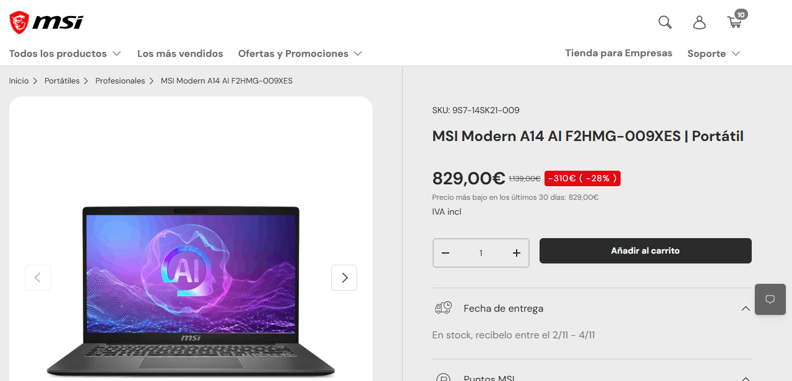

https://es-store.msi.com/products/modern-a14-ai-f2hmg-009xes-portatiles

https://www.energystar.gov/productfinder/product/certified-computers/details/4478547

Iván Gimeno Montoya
# Actividades
## Actividad 1. Analizar necesidades y componentes
### 1. Identificad CPU, RAM, SSD, GPU, placa base e interfaces de entrada/salida. Explicad su función y qué características importan para este encargo.

- **CPU**
    * **Modelo**: AMD Ryzen™ 7 250 (8 cores, Max Boost Clock 3.3 GHz)
    * **Función**: Es el cerebro del ordenador; se encarga de procesar las instrucciones del sistema operativo, aplicaciones y tareas en segundo plano.
    * **Características importantes**: Sus 8 núcleos aportan una excelente capacidad multitarea, permitiendo ejecutar aplicaciones de ofimática avanzada, navegación pesada y software profesional de forma fluida.

- **RAM**
    * **Modelo**: 32 GB (16 GB * 2) DDR5
    * **Función**: Memoria de acceso aleatorio donde se cargan de forma temporal los datos de los programas y archivos que estás usando activamente para un acceso ultra rápido.
    * **Características importantes**: La capacidad de 32 GB en doble canal (*dual-channel*) es ideal para mantener decenas de pestañas abiertas, máquinas virtuales o programas pesados sin ralentizaciones.

- **SSD**
    * **Modelo**: 1 TB NVMe SSD PCIe Gen4
    * **Función**: Almacenamiento permanente de alta velocidad para el sistema operativo, programas y archivos personales.
    * **Características importantes**: Al ser NVMe PCIe Gen4, ofrece tasas de lectura y escritura sumamente rápidas (arranque del sistema en pocos segundos y transferencia de archivos instantánea). 

- **GPU**
    * **Modelo**: AMD Radeon™ Graphics (Integrada)
    * **Función**: Procesador gráfico encargado de renderizar la interfaz visual, vídeos y gráficos en pantalla.
    * **Características importantes**: Al estar integrada en el procesador, comparte memoria con la RAM. Es perfecta para tareas multimedia de alta definición, reproducción de vídeo 4K y ofimática, ahorrando batería frente a gráficas dedicadas.

- **Placa base**
    * **Modelo**: Propietaria de MSI (Chipset SoC integrado / Serie MS-14SK)
    * **Función**: El circuito impreso principal que conecta físicamente todos los componentes del portátil (CPU, RAM, almacenamiento y puertos) permitiendo su comunicación.
    * **Características importantes**: Su diseño compacto está optimizado para el chasis ultrafino de 14 pulgadas del portátil, integrando conectividad moderna como Wi-Fi 6E y controladoras de alta velocidad.

- **Interfaces de entrada/salida (I/O)**
    * **Modelo**: 
      * 2x USB Type-C (USB3.2 Gen2 / DisplayPort™ / Power Delivery 3.0)
      * 2x USB Type-A USB3.2 Gen1
      * 1x HDMI™ 2.1 (4K @ 60Hz)
      * 1x Mic-in/Headphone-out Combo Jack
      * 1x Lector de tarjetas microSD
    * **Función**: Conectar periféricos externos, pantallas adicionales, dispositivos de audio y transferencia de datos.
    * **Características importantes**: Los puertos USB-C con Power Delivery y DisplayPort aportan una gran versatilidad (permiten cargar el portátil y conectar monitores externos con un solo cable), mientras que el HDMI 2.1 garantiza salida de vídeo fluida a pantallas 4K.

## Actividad 2. Dimensionar cuatro máquinas virtuales

El profesorado puede necesitar estas máquinas **funcionando simultáneamente**:

|VM|Sistema operativo invitado|RAM asignada|
|-|-|-|
|1|Windows 11|8 GB|
|2|Ubuntu Desktop|4 GB|
|3|Ubuntu Server|2 GB|
|4|Windows 11|8 GB|

### 1. Calculad la RAM total asignada a las VM y la que queda para el anfitrión con 32 y 64 GB de RAM. Indicad si la memoria restante es suficiente y justificadlo.

Para calcular la memoria restante debemos de sumar los siguiente datos (aproximados):

* Windows 11 base: 6 GB
* VirtualBox + vmmem (virtualización): 1 GB
* RAM total máquinas host: 20 GB

Por tanto el consumo total son 27 GB. 

Memoria restante para cada configuración:

* Equipo 32 GB: 5 GB restantes
* Equipo 64 GB: 37 GB restantes

### 2. Proponed cuántas vCPU asignaríais a cada VM. Explicad qué problemas puede generar asignar demasiadas.

### 3. Repartid 1 TB de almacenamiento entre el anfitrión, aplicaciones, archivos, discos virtuales y espacio libre. Indicad las capacidades en una tabla.

### 4. Valorad el comportamiento esperado durante el uso simultáneo de las cuatro VM.